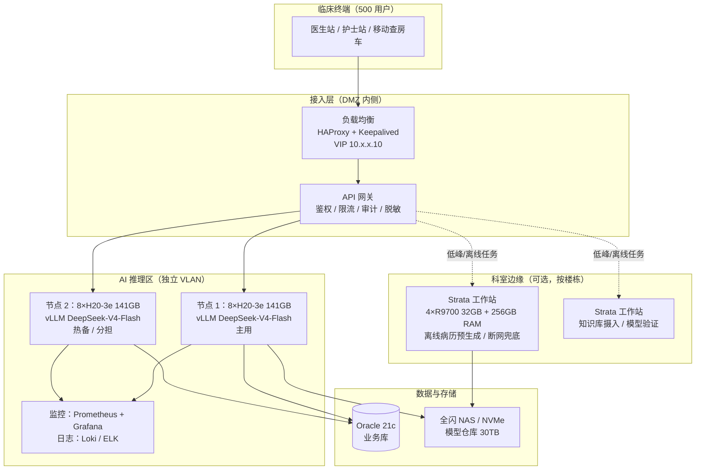

# Strata 运行 DeepSeek 的医院硬件方案（500 用户）

> 编制日期：2026-10-30
> 适用场景：医院内网私有化部署 DeepSeek，支撑 MedAiAssistant 等 AI 辅助系统的 500 名临床用户
> 结论口径：本方案区分「500 注册用户」「500 同时在线」「500 同时生成」三种需求，三者硬件差 10 倍以上，必须先定口径再采购

---

## 0. 一句话结论

**Strata 不适合承担 500 人核心推理，但非常适合做院内边缘节点。** 它的单机实测是「4 卡 R9700、单流 31 token/s、一次只回答一个请求」，单引擎并行槽上限 8 路，且只在单机内做数据并行（`replicas` 切卡），没有跨节点集群能力。500 人核心链路必须用 vLLM/SGLang 多卡服务器集群；Strata 放到科室边缘、离线批处理、网络中断兜底的位置，反而能发挥它「消费级硬件跑 671B」的独特价值。

推荐架构：**中心 2 台 8×H20 做双活推理集群（vLLM）+ 若干台 Strata 工作站做科室边缘**。预算区间约 290–390 万元（详见 §5）。

---

## 1. 先厘清「500 人高并发」

这是本方案最容易被拍脑袋的一步。医院 500 人使用 AI，「500 人」几乎从来不等于「500 路同时推理」。按下面的模型先算清到达率，再谈硬件，否则会多买 5–10 倍机器。

### 1.1 容量模型

用 Little's Law 估算在制请求数：

```
并发在制 L = 到达率 λ(req/s) × 单请求平均服务时长 W(s)
```

参数取值（医院临床工作流，可按本院实际调整）：

| 参数 | 取值 | 依据 |
|---|---|---|
| 注册用户 | 500 | 给定 |
| 日活比例 | 55% → 275 人 | 医院信息系统常见日活 |
| 人均日交互 | 14 次 | 医生 12–20 次（病历、查房、质控、问答），护士 6–10 次 |
| 日请求量 | ≈ 3,850 次 | 275 × 14 |
| 峰值小时占比 | 35% | 早交班 07:30–09:00、下午写病历 14:00–17:30 双峰 |
| 峰值小时请求 | ≈ 1,350 次 | 3,850 × 35% |
| 峰值到达率 λ | ≈ 0.375 req/s | 1,350 / 3,600 |
| 平均服务时长 W | ≈ 30 s | 问答 15 s、文书生成 50 s 加权 |
| 平均在制 L | ≈ 11 路 | 0.375 × 30 |
| 峰值/均值系数 | 2.0 | 交班瞬时聚集 |
| **峰值并发（建议规划值）** | **≈ 25–30 路** | 留 30% 余量 |

### 1.2 三种口径与硬件档位

| 口径 | 峰值并发 | 中心节点需求（8×H20） | 体验 | 现实性 |
|---|---|---|---|---|
| **A. 500 注册用户**（推荐按此规划） | 25–30 路 | 1 台生产 + 1 台容灾 | 单路 60+ token/s，TTFT < 2 s | 绝大多数三甲医院实际形态 |
| **B. 500 人同时在线** | 50–80 路 | 2–3 台 | 单路 25–40 token/s | 极端峰值，需限流保护 |
| **C. 500 路同时生成** | 500 路 | 10–14 台 | 满载排队 | 不现实，应做排队 + 分级降级 |

> **建议**：合同与验收按 A 档写，架构按 B 档留扩展位，用 C 档做压力测试上限。不要按 C 档采购。

### 1.3 必须让业务方确认的三个数

1. 峰值小时真实请求量（可从现有系统埋点或 HIS 操作日志估算）；
2. 单次生成的平均输出 token 数（病历生成 1,500–2,500，问答 300–800）；
3. 可接受的 P95 首字延迟与整段完成时间（建议 TTFT ≤ 2 s、800 token ≤ 20 s）。

---

## 2. Strata 的真实能力边界

以下判断来自本机 Strata Terminal 0.1.51 的源码与实测数据，不是推测。

### 2.1 Strata 是什么

Strata 是面向**单机/工作站**的本地推理引擎，核心能力是把 MoE 大模型的专家权重留在显存、溢出部分放系统内存、再不够从 NVMe 流式读取，从而在消费级或工作站硬件上跑 671B 级 MoE 模型。

本机现状（可用于同规模验证）：

| 项 | 值 |
|---|---|
| 版本 | Strata Terminal 0.1.51，引擎 0.1.50 |
| 显卡 | RTX 5070 12 GB（单卡） |
| 内存 | 64 GB（Strata 锁定 32.4 GB arena） |
| 当前模型 | qwen3.8-flash-next-q2_0，128K 上下文 |
| 显存占用 | 约 10.3 / 12.2 GB，余量约 0.5 GB |
| 并发配置 | `conversation_cache_slots = 2`，未开 `--batch`，即**单序列** |

### 2.2 它支持的 DeepSeek 规格

Strata 通过 `strata_control/dsv41_fit.py` 原生适配 **DeepSeek-V4.1-Flash**（40 层 × 384 路由专家，top-6）。三套可用权重：

| 权重集 | 专家体积 | 质量（相对原始模型 PPL） | 磁盘需求 | 最低内存 |
|---|---|---|---|---|
| Unsloth UD-Q8_K_XL | 288.8 GB | 基准（最好） | 508.4 GB | ≈ 305 GB |
| IST-DAS 2.25 bpw | 149.1 GB | +7.3% | 274 GB | 44 GB |
| IST-DAS 2.00 bpw | 132.1 GB | +15.5% | 257 GB | 40 GB |
| IST-DAS 1.75 bpw | 114.6 GB | +21%（散文明显变差） | 239 GB | 34 GB |

**医疗场景注意**：2.00 bpw 及以下属于激进量化，PPL 上升 15%–21%。病历摘要、诊断推理这类对措辞与数值敏感的任务，建议至少 2.25 bpw 或 UD-Q8_K_XL，并在 POC 阶段用脱敏病历做人工盲评。不要用 1.75 bpw 上临床。

### 2.3 官方实测速度（硬证据）

`dsv41_fit.py` 记录的实测：

| 硬件 | 首字/预填 | 生成速度 | 备注 |
|---|---|---|---|
| RTX 5070 12 GB + 64 GB RAM + 3.6 GB/s NVMe | 121 tok/s @4K | **4.7 tok/s** | 单请求 |
| RTX 3060 12 GB + 46 GB RAM | — | 7.2 tok/s | 单请求 |
| 4× Radeon AI PRO R9700 32 GB + 251 GB RAM | 143–181 tok/s @3K | **25–31 tok/s** | `--tp 2`，**一次一个回答** |

### 2.4 硬上限（源码级）

| 约束 | 值 | 出处 |
|---|---|---|
| 单引擎并行槽上限 | **8**（`PARALLEL_MAX = 8`） | `serve/server.py` |
| 单副本并行槽（UI 建议） | 12 GB 卡 1 路、20 GB 2 路、24 GB 3 路、32 GB+ 4 路 | `docs/TERMINAL_LAUNCH.md` |
| 扩展方式 | `replicas`：把本机多卡切成 N 组，每组一个独立引擎，前置 HTTP 做前缀缓存路由 | `serve/replicas.py` |
| 跨节点集群 | **无**。没有分布式调度、没有跨机张量并行、没有集群管理 | 全部源码 |
| 单机显卡上限 | 面向工作站，官方文档按 4 卡描述（`--gpu-roles` 最多 4 卡命名） | `docs/TERMINAL_LAUNCH.md` |

也就是说，一台 8 卡机用 Strata 最多得到「2 个副本 × 4 路 ≈ 8 路并发」，且每路速度会被分摊。要 500 路并发，理论上需要 60 台以上，运维上不成立。

### 2.5 结论

| 维度 | Strata | vLLM / SGLang |
|---|---|---|
| 定位 | 单机、工作站、边缘 | 数据中心、多卡、多节点 |
| 最佳并发 | 1–8 路 | 数十至数百路 |
| 671B 硬件门槛 | 4 卡工作站 + 251 GB 内存即可 | 8 卡 H20 / H100 |
| 单路速度 | 25–31 tok/s（4×R9700） | 600+ tok/s（8×H20 单流） |
| 量化激进度 | 1.75–2.25 bpw 可用 | FP8 原生 |
| 运维复杂度 | 低（Windows 可跑、单进程） | 高（容器、驱动、并行策略） |
| 500 人核心链路 | ❌ 不可行 | ✅ 可行 |

**所以本方案给两条路：A 是推荐的生产架构，B 是纯 Strata 能做到什么、代价多少。**

---

## 3. 方案 A（推荐）：vLLM 中心集群 + Strata 边缘节点

### 3.1 架构



设计要点：

1. **中心只放推理，不放业务数据**。网关单向从 HIS/EMR 取脱敏片段，推理节点不直连生产库。
2. **双机不是主备冷备，而是双活分担**。医院要求 99.9% 可用，单机故障时另一台接管全部流量（需按 B 档容量预留，或故障时降级到小模型）。
3. **Strata 边缘节点按楼栋部署**，承担三类任务：夜间批量生成病历初稿、科室内网断连时的兜底问答、知识库文档摄入（复用现有 `kb-local-ingest` 流程）。
4. **模型版本蓝绿切换**：新版权重先加载到空闲节点，验证通过后切 VIP，不中断服务。

### 3.2 中心节点硬件配置（单台）

| 部件 | 配置 | 说明 |
|---|---|---|
| GPU | 8 × NVIDIA H20-3e 141 GB HBM3 | 8 卡 NVLink/NVSwitch 互联，FP8 原生支持 |
| CPU | 2 × Intel Xeon Platinum 8480+ / AMD EPYC 9554 | 双路，≥ 96 核 |
| 内存 | 1 TB DDR5 ECC | KV Cache 主机侧与加载缓冲 |
| 系统盘 | 2 × 960 GB NVMe SSD（RAID1） | |
| 数据盘 | 4 × 7.68 TB NVMe SSD（RAID5） | 模型仓库 + 日志，单机 ≥ 20 TB 可用 |
| 网络 | 2 × 25 GbE（业务）+ 1 × 100 GbE/IB（多机互联，可选） | RoCEv2 |
| 电源 | 2 × 2000 W 冗余（钛金） | 整机满载约 5.5–6.5 kW |
| 机箱 | 4U/8U GPU 服务器，8 卡直通 | 浪潮 NF5688M7、华为 FusionServer、超微 821GE 同级 |
| 质保 | 原厂 3 年 7×24 4 小时响应 | 医院采购硬性要求 |

### 3.3 容量核算（方案 A）

基于 2026-08 GPUStack 实测（8×H20-3e 跑 DeepSeek-V4-Flash-0731，DSpark 投机解码）：

- KV Cache 可用约 **108 GiB ≈ 683 万 token**；
- 单流输出 **600+ token/s**；
- 10 路 × 64K 输入 / 3K 输出 稳定运行；
- 单节点约 **25 路 64K 长上下文并发**。

换算到本项目的短请求（2K 输入 / 800 输出）：

| 场景 | 单节点可承载并发（保守） | 依据 |
|---|---|---|
| 短问答（2K/800） | 50–60 路 | KV 显存可容 2,000+ 路，瓶颈在算力与调度 |
| 病历生成（8K/2K） | 25–30 路 | 接近实测 64K 场景的 1.5 倍余量 |
| 混合负载（规划值） | **25–30 路** | 与 §1 峰值并发对齐 |

**结论：A 档（500 注册、峰值 25–30 路）单台 8×H20 即可满足，第二台用于容灾与峰值分担。**

### 3.4 Strata 边缘节点配置（单台）

| 部件 | 配置 | 说明 |
|---|---|---|
| GPU | 4 × Radeon AI PRO R9700 32 GB（或 2 × RTX 5090 32 GB） | 官方实测配置 |
| 内存 | 256 GB DDR5 ECC | 251 GB 实测；留余量给系统 |
| CPU | AMD Threadripper / EPYC 16–24 核 | 专家 CPU lane 需要多核 |
| 存储 | 2 × 4 TB NVMe（RAID1，≥ 3.5 GB/s 顺序读） | n-gram 表在 SSD 上流式读，**慢盘直接拖垮每字速度** |
| 电源 | 1600 W 钛金 | |
| 形态 | 塔式工作站或 4U 机架 | 可放科室弱电间 |
| 单价 | 约 15–20 万元 | 以实际询价为准 |

单台能力：DeepSeek-V4.1-Flash（2.00/2.25 bpw）单流 25–31 token/s，并发 1–8 路。**只用于离线/低峰/兜底，不做实时主链路。**

---

## 4. 方案 B（纯 Strata）：能做到什么、代价多少

如果因预算或合规原因必须全 Strata，以下是可落地的形态与硬约束。

### 4.1 单机能力上限

| 配置 | 并发 | 单路生成速度 | 适用 |
|---|---|---|---|
| 1 台 4×R9700（默认） | 1 路 | 25–31 tok/s | 单人/单科室 |
| 1 台 4×R9700 + `replicas: 2` | ≈ 8 路 | 约 6–10 tok/s | 3–5 人同时用 |
| 1 台 8×R9700 + `replicas: 2`（若成立） | ≈ 16 路 | 约 4–8 tok/s | 小科室 |
| 多台 + 外部网关 | 线性叠加 | 同上 | 需自建路由与运维 |

### 4.2 覆盖 500 用户需要多少台

按峰值 25–30 路、每台约 8–16 路、且单路速度已降到 5 tok/s 左右（生成 800 token 需 160 秒，体验不可接受），实际要保证体验只能按每台 4–6 路算：

| 目标 | 台数 | 硬件投入 | 结论 |
|---|---|---|---|
| 500 注册、峰值 25 路 | 5–6 台 | 约 90–120 万元 | 速度不达标，仅能夜间批处理 |
| 500 同时在线、峰值 75 路 | 15 台 | 约 250–300 万元 | 与方案 A 同价，性能差一个量级 |
| 500 同时生成 | 60+ 台 | 不可行 | 放弃 |

**方案 B 的合理定位不是「替代中心集群」，而是「覆盖 100 人以内科室、离线场景、灾备兜底」。** 若强行用它扛 500 人，钱没少花、体验更差、运维更复杂。

### 4.3 什么情况下选 B

- 单科室/单院区试点，用户 < 100；
- 明确要求「数据不出科室」，每层楼独立部署；
- 预算分年、先小后大；
- 作为中心集群的灾备（主集群故障时降级可用）。

---

## 5. 预算汇总

> 价格为 2026-10 市场参考区间，最终以招标询价为准；H20 受出口管制影响供货周期可能 8–16 周。

### 5.1 方案 A 标准版（推荐）

| 项目 | 数量 | 单价（万元） | 小计（万元） |
|---|---|---|---|
| 8×H20-3e 141GB 推理服务器（含 3 年质保） | 2 | 110–140 | 220–280 |
| 25G/100G 交换机、防火墙策略、机柜 | 1 套 | 15–25 | 15–25 |
| 全闪存储 30 TB（模型仓库 + 日志） | 1 套 | 15–25 | 15–25 |
| 机房改造（UPS 20 kVA、精密空调 25 kW、配电） | 1 套 | 20–35 | 20–35 |
| 实施、集成、压测、培训 | 1 项 | 20–30 | 20–30 |
| **合计** | | | **290–395** |

### 5.2 方案 A 经济版（先上 1 台 + 边缘）

| 项目 | 数量 | 小计（万元） |
|---|---|---|
| 8×H20 推理服务器 | 1 | 110–140 |
| Strata 边缘工作站（4×R9700 + 256 GB） | 2 | 30–40 |
| 网络、存储、机房 | 1 套 | 45–70 |
| 实施与压测 | 1 项 | 15–20 |
| **合计** | | **200–270** |

适合：先覆盖 200–300 人，第二年按实测数据扩容第二台 H20。

### 5.3 方案 B 纯 Strata（100 人以内）

| 项目 | 数量 | 小计（万元） |
|---|---|---|
| Strata 工作站（4×R9700 + 256 GB + 8 TB NVMe） | 2 | 30–40 |
| 万兆交换机、机柜 | 1 套 | 3–5 |
| 实施 | 1 项 | 5–8 |
| **合计** | | **38–53** |

### 5.4 运维成本（年）

| 项目 | 方案 A | 方案 B |
|---|---|---|
| 电费（0.8 元/kWh，满载 60%） | 2.5–3.5 万 | 0.6–1.0 万 |
| 硬件维保（第 4 年起） | 15–25 万 | 1.5–2.5 万 |
| 专职运维（0.5–1 人） | 10–20 万 | 5–10 万 |

---

## 6. 医院环境专项要求

### 6.1 合规

| 要求 | 落地措施 |
|---|---|
| 数据不出院 | 全本地推理，模型权重离线摆渡更新，推理服务无外网出口 |
| 《医疗卫生机构网络安全管理办法》 | AI 区独立安全域，边界防火墙 + IDS/IPS |
| 等保三级 | 双因子登录、操作审计、日志留存 ≥ 6 个月、漏洞扫描 |
| 《个人信息保护法》 | 送模前脱敏（姓名/身份证/手机号/医保号），推理节点不落盘原文 |
| 生成内容标识 | AI 生成文书标注「AI 辅助生成，医师复核」 |
| 医疗 AI 定位 | 辅助决策，不作为诊断依据，医师签字后方可入库 |
| 审计追溯 | 每次请求记录：用户、时间、输入摘要哈希、模型版本、输出哈希 |

### 6.2 网络分区

```
互联网 ── 防火墙 ── DMZ（反向代理）
                      │
                 核心业务区（HIS/EMR/LIS/PACS）
                      │  单向 API 网关（只读、脱敏）
                 AI 推理区（独立 VLAN，禁止访问互联网）
                      │
                 管理区（堡垒机、监控）
```

- 推理节点**不直连** Oracle 生产库，只通过后端服务取数；
- 模型更新走离线介质或内网镜像仓库，禁止推理机直接拉公网；
- 管理口与业务口分离，禁止 GPU 服务器双网卡桥接。

### 6.3 机房

| 项 | 要求 |
|---|---|
| 单机功耗 | 8×H20 整机满载 5.5–6.5 kW；双机 12–13 kW |
| 制冷 | 精密空调 ≥ 25 kW，冷通道封闭，进风 22±2 ℃ |
| 供电 | 双路市电 + UPS（满载 30 min）+ 柴油发电机 |
| 承重 | 8U GPU 服务器约 60–80 kg，机柜承重 ≥ 1,200 kg |
| 噪音 | 满载 75–85 dB，必须独立机房，不能放弱电间 |
| 网络 | 业务 25 GbE，多机互联 100 GbE/IB（若做张量并行跨机） |

### 6.4 高可用

| 指标 | 目标 | 措施 |
|---|---|---|
| 可用性 | ≥ 99.9% | 双节点 + VIP 漂移，单点故障 30 s 内切换 |
| RTO | ≤ 30 min | 备用节点预加载权重 |
| RPO | 0（模型无状态） | 会话状态外置 Redis |
| 降级 | 大模型不可用时 | 回落小模型（7B/14B）或规则模板，保证文书流程不断 |

---

## 7. 验收与压测

采购前必须做 POC，采购后必须做验收压测，指标写进合同。

### 7.1 压测方法

1. **语料**：从本院取 200 份脱敏病历，覆盖入院记录、查房记录、出院小结、质控。
2. **工具**：`vllm bench serve` 或 Locust，模拟 500 用户到达率（按 §1 模型生成泊松流）。
3. **阶梯**：10 → 25 → 50 → 80 → 120 路，每档稳定 10 分钟。
4. **观测**：TTFT、TPOT、吞吐、错误率、GPU 利用率、显存、P95/P99。

### 7.2 验收指标（建议写入合同）

| 指标 | 门槛 | 目标 |
|---|---|---|
| 首字延迟 TTFT P95 | ≤ 3 s | ≤ 2 s |
| 单路生成速度（25 路并发下） | ≥ 20 tok/s | ≥ 30 tok/s |
| 800 token 文书完成时间 P95 | ≤ 40 s | ≤ 25 s |
| 错误率（500 用户流量） | ≤ 1% | ≤ 0.5% |
| 单节点故障切换 | ≤ 60 s | ≤ 30 s |
| 连续 72 小时稳定性 | 无 OOM、无重启 | 同左 |

### 7.3 质量验收

技术指标达标不等于临床可用。必须做**双盲人工评审**：

- 抽 100 份 AI 生成文书，由 2 名主治以上医师按「事实准确性 / 完整性 / 术语规范 / 可直接采纳率」打分；
- 对比 2.25 bpw 与 UD-Q8_K_XL 两套权重，量化损失是否可接受；
- 重点看：数值（检验值、剂量）、否定词、时间线、鉴别诊断是否被量化噪声破坏。

---

## 8. 落地路线

| 阶段 | 周期 | 交付物 | 决策点 |
|---|---|---|---|
| P0 需求与合规 | 2 周 | 到达率模型、数据流图、等保差距分析 | 确认 A/B/C 口径 |
| P1 POC | 4 周 | 1 台 8×H20 临时环境，跑真实语料压测 | 实测并发与速度，校准 §1 模型 |
| P2 招标采购 | 6–12 周 | 技术参数书、评标标准 | 供货周期、信创要求 |
| P3 部署集成 | 4 周 | 双机集群、网关、监控、脱敏链路 | 压测达标 |
| P4 灰度 | 4 周 | 先 50 人（2 个科室）试用 | 采纳率、投诉率 |
| P5 全量 | 2 周 | 500 人开放，SLA 上线 | — |

**关键建议：P1 的 POC 不要省。** 用一台机器实测本院真实到达率，比任何模型测算都准，能直接决定买 1 台还是 3 台，省下的钱远超 POC 成本。

---

## 9. 风险清单

| 风险 | 影响 | 应对 |
|---|---|---|
| 把「500 人」当「500 并发」采购 | 多花 500–800 万 | 按 §1 模型先算到达率，POC 验证 |
| 量化过激（1.75/2.00 bpw）导致临床文本质量下降 | 医疗差错风险 | 至少 2.25 bpw；双盲评审；关键场景用 Q8 |
| H20 供货周期长 | 项目延期 | 提前锁货；备选昇腾 910B（性能约 1/3，需 8 台以上） |
| 长上下文请求挤占 KV Cache | 排队雪崩 | 限制 `max-model-len` 32K–64K；超长请求走离线队列 |
| 单机故障 | 全院 AI 中断 | 双机 + 降级小模型 + 熔断 |
| 机房电力/制冷不足 | 降频、宕机 | 提前核算 13 kW 负载，改造 UPS 与空调 |
| 模型幻觉被直接采纳 | 医疗质量事故 | 强制医师复核、AI 标识、关键字段结构化校验 |
| Strata 边缘节点被误当主链路 | 体验崩塌 | 网关层限流，边缘节点只接离线/低峰队列 |

---

## 10. 待确认事项

1. **「500 人高并发」按哪个口径？**（A 注册 / B 同时在线 / C 同时生成）——直接决定预算 300 万还是 3000 万。
2. 是否必须信创国产化？若是，方案改为 8×昇腾 910B 多节点，性能约为 H20 的 1/3，台数翻 3 倍。
3. 现有 MedAiAssistant 的调用形态：同步问答为主，还是批量文书生成？两者容量模型不同。
4. 是否有现成 GPU 服务器或机房余量？可复用则省 50–100 万。
5. 数据脱敏在哪一层做？（建议在 API 网关，推理节点只见脱敏文本）
6. 是否接受「高峰排队 + 夜间批处理」？接受则可显著降低硬件投入。

---

## 附录 A：Strata 关键源码位置（供技术复核）

| 文件 | 内容 |
|---|---|
| `strata_control/dsv41_fit.py` | DeepSeek-V4.1-Flash 权重规格、显存/内存规划、实测速度 |
| `serve/server.py` | `PARALLEL_MAX = 8`，单引擎并行槽上限 |
| `serve/replicas.py` | 单机多副本切卡与路由，无跨节点能力 |
| `docs/TERMINAL_LAUNCH.md` | 并行请求建议值（12 GB→1、32 GB+→4） |
| `strata_cli/launch/catalog.py` | 模型目录与上下文推荐规则 |

## 附录 B：外部实测来源

- GPUStack：8×H20-3e 与 8×昇腾 910B 部署 DeepSeek-V4-Flash-0731 实测（2026-08），H20 单流 600+ TPS、单机约 25 路 64K 并发；910B 单流约 100 TPS、约为 H20 的 1/3。
- Strata 官方实测（`dsv41_fit.py` 记录，2026-10-20/23）：4×R9700 单流 25–31 tok/s；RTX 5070 单流 4.7 tok/s。

> 外部数据仅作容量锚点，实际以本院 POC 为准。
