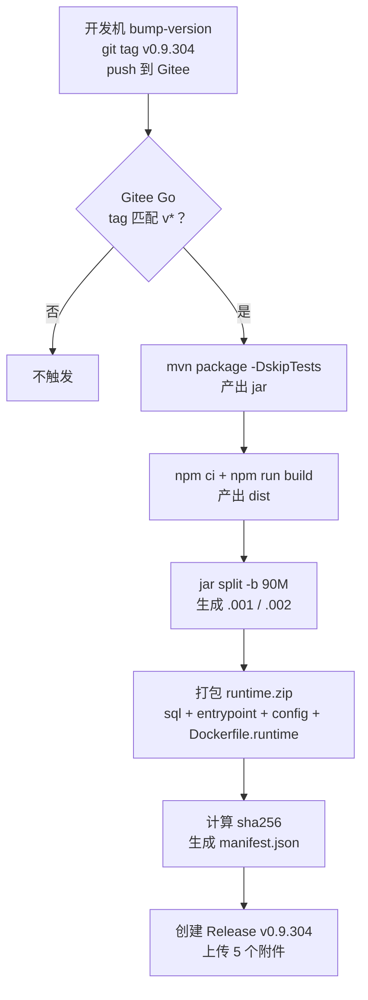
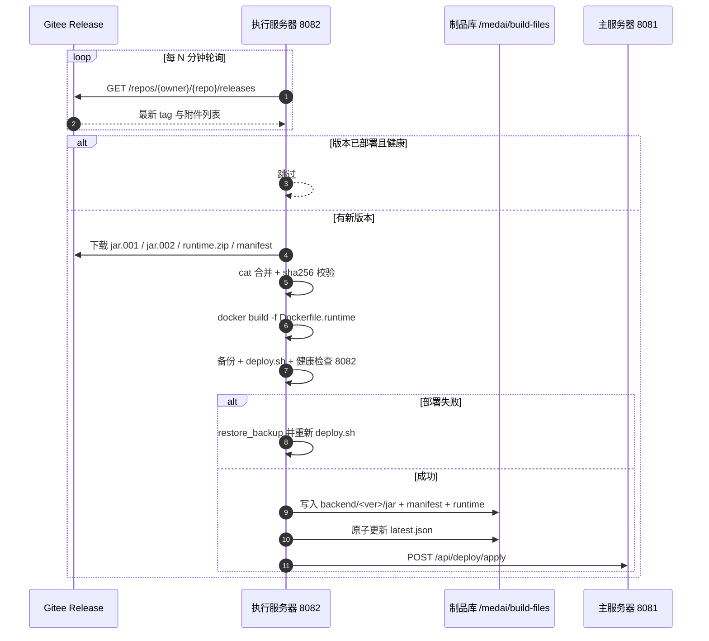
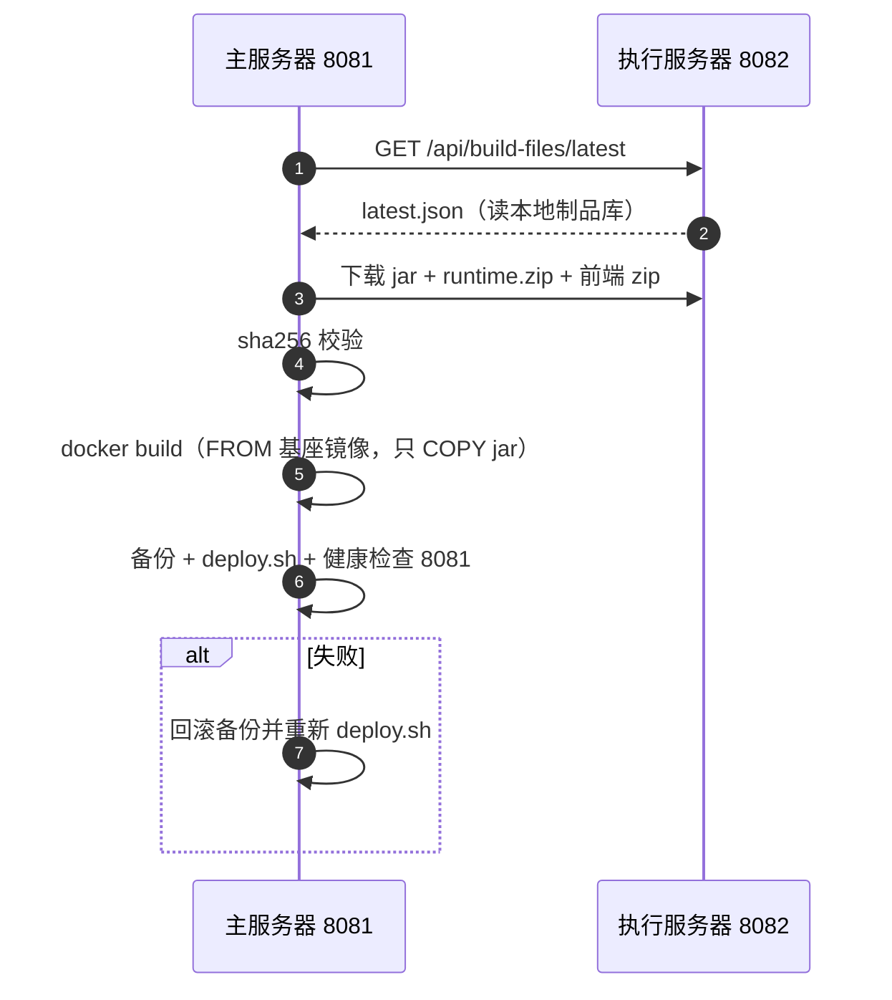

# 自动部署链路改造设计 v2（Gitee 构建 + jar 分卷 + 生产侧构建镜像）

> 状态：**设计稿，代码尚未修改**。
> 决策前提（2026-11-04 已确认）：① jar 分卷 2 个绕开 Gitee 100MB 单附件限制；② 生产侧允许 `docker build`，只 COPY jar。

---

## 一、定稿架构（四步）

```
① 开发机：bump-version → git tag v0.9.304 → push 到 Gitee
② Gitee Go（tag 触发）：mvn package → jar；npm build → 前端 zip；分卷；发布 Release 附件
③ 执行服务器：轮询 Gitee Release → 下载分卷 → 合并校验 → docker build → 自动部署
④ 主服务器：轮询执行服务器 /api/build-files → 下载 jar → docker build → 自动部署
```

与旧设计的本质区别：
- **不再分发镜像 tar**（237MB 超限），只分发 jar（121.8MB → 分 2 卷）；
- **镜像在生产侧构建**（只 COPY jar，不含源码，符合「源码不出医院」）；
- 执行服务器仍是主服务器的「制品源」，主服务器不需要访问 Gitee。

---

## 二、制品清单与分卷规则

Gitee Release（tag 与版本号同名，如 `v0.9.304`）附件：

| 附件 | 大小 | 说明 |
|---|---|---|
| `med_ai_assistant_backend-0.9.304.jar.001` | ~90 MB | jar 第 1 卷 |
| `med_ai_assistant_backend-0.9.304.jar.002` | ~32 MB | jar 第 2 卷 |
| `med_ai_assistant_runtime-0.9.304.zip` | ~200 KB | `sql/` + `docker-entrypoint*.sh` + `config/` + `Dockerfile.runtime` |
| `med_ai_assistant_frontend-0.9.304.zip` | ~40 MB | dist + nginx + compose + 离线镜像 |
| `med_ai_assistant_manifest-0.9.304.json` | <1 KB | 各文件 sha256 + 合并后 jar 的 sha256 |

**分卷规则**：每卷 ≤ 90MB（留 10MB 余量），命名 `.001` / `.002`，按序 `cat` 合并；合并后必须校验 sha256。

> 当前 jar 121.8MB → 90.0MB + 31.8MB，两卷都在 100MB 限制内。jar 未来若涨到 180MB 会自动分成 2 卷（90+90），超过 180MB 才需要第 3 卷——流水线按 `split -b 90M` 动态分，不写死卷数。

---

## 三、两个必须补的前置条件（本次讨论新发现）

### 3.1 基座镜像（否则生产侧 build 必然失败）

两个 Dockerfile 里都有 `apt-get update && apt-get install curl netcat-openbsd`：

```dockerfile
RUN apt-get update ... && apt-get install -y --no-install-recommends curl netcat-openbsd
```

生产服务器**不能访问外网**，`docker build` 到这一层就会卡死失败。

解法：开发机预构建一个**运行基座镜像**，生产一次性 `docker load`：

```
med-ai-jre-base:21   （FROM eclipse-temurin:21-jre + apt curl/netcat + TZ + 目录）
   ├─ 主服务器镜像：FROM med-ai-jre-base:21 + COPY jar + sql + entrypoint
   └─ 执行服务器镜像：FROM med-ai-jre-base:21 + COPY jar + entrypoint
```

之后每次发版的 `docker build` **只走 COPY 层，不联网、秒级完成**。

### 3.2 Dockerfile 依赖仓库文件（不只是 jar）

| Dockerfile | 除 jar 外还依赖 |
|---|---|
| 主服务器 `Dockerfile` | `sql/`（16 个文件）、`deploy/main-linux-oracle/docker-entrypoint.sh` |
| 执行服务器 `Dockerfile.execution.linux` | `deploy/execution-linux/docker-entrypoint-execution.sh` |

生产侧没有仓库目录，所以这些文件必须随 `med_ai_assistant_runtime-<ver>.zip` 一起分发（体积仅 ~200KB），并配一个「运行版 Dockerfile」，只做 `FROM med-ai-jre-base:21` + COPY。

---

## 四、完整时序

### 4.1 构建侧（Gitee Go）



### 4.2 执行服务器（检测 → 下载 → 构建 → 部署）



### 4.3 主服务器（从执行服务器拉取 → 构建 → 部署）



---

## 五、代码改动清单

| 层 | 改动 | 说明 |
|---|---|---|
| Gitee | 新增 Gitee Go 流水线配置（`.workflow/`） | tag `v*` 触发；构建、分卷、发 Release |
| 执行服务器 | 新增 `gitee-pull-release.sh`（或改造 `auto-deploy-execution.sh`） | 轮询 Gitee API → 下载分卷 → 合并校验 → build → 写制品库 → deploy |
| 执行服务器 | 新增 `Dockerfile.runtime` | `FROM med-ai-jre-base:21`，只 COPY jar + runtime 文件，不联网 |
| 主服务器 | 改造 `auto-deploy-backend.sh` | 从 `8082/api/build-files` 下载 jar（不再下载镜像 tar）→ 本地 build → deploy |
| Java | `BuildFileController` 增加通用制品下载端点 | `GET /api/build-files/artifact/{type}/{version}/{filename}`，白名单防穿越 |
| Java | `BuildFileController.getLatestVersions()` | 优先读本地 `latest.json`，读不到再走旧 Release 查询 |
| 基础设施 | 基座镜像 | 开发机构建 `med-ai-jre-base:21` 并导出 tar，生产两台各 load 一次 |

---

## 六、失败模式

| 场景 | 处理 |
|---|---|
| Gitee 附件下载中断 | 断点续传（`curl -C -`），合并前校验 sha256 |
| 分卷缺失/校验失败 | 丢弃重下，**不触碰现有部署** |
| docker build 失败 | 保留旧镜像，不切换容器 |
| 健康检查失败 | 回滚备份目录并重新 deploy |
| Gitee 不可达（网络抖动） | 本轮跳过，下轮重试；连续 N 次告警 |
| 基座镜像缺失 | build 前显式检查 `docker image inspect med-ai-jre-base:21`，缺失则中止并提示 |

---

## 七、实施顺序

1. **验证 Gitee Go 能力**：tag 触发 + maven 构建 + `split` + Release 附件上传（决定整条链路是否成立）；
2. **构建基座镜像**：开发机 `med-ai-jre-base:21`，生产两台 `docker load`，用现有 jar 做一次 build 验证「不联网可构建」；
3. **执行服务器**：Gitee 轮询 + 分卷合并 + build + 写制品库；
4. **主服务器**：从 8082 拉 jar + build + 部署；
5. **联调**：测试服先打通，再上生产。

---

## 八、待验证清单

- [ ] Gitee Go 构建机是否预装 Docker（路线不需要，但 split/zip 需要基础工具）
- [ ] Gitee Release 附件通过 API 上传的最大文件是否也是 100MB（分卷 90MB 应安全）
- [ ] Gitee 私有仓库 Release 资产的下载是否支持断点续传（`Range`）
- [ ] 执行服务器容器内是否有 `docker` 命令（当前容器内没有；需要在宿主机执行）
- [ ] 基座镜像大小与 load 耗时（预计 300~400MB）
