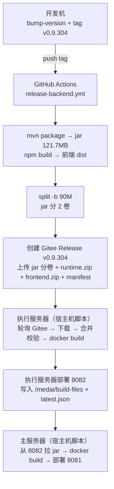
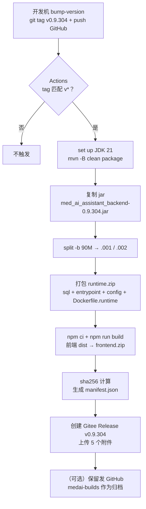
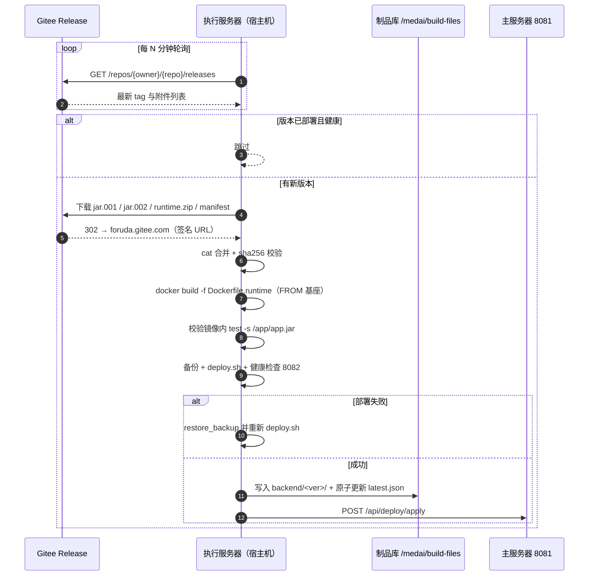
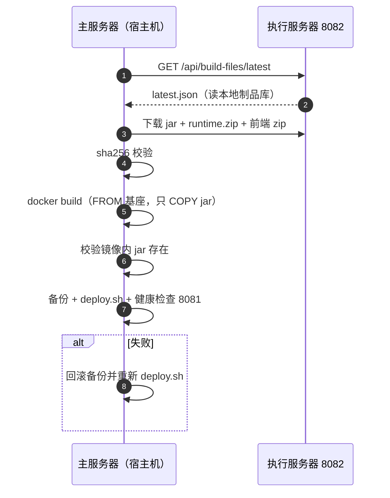

# 自动部署链路改造设计（定稿 v3）

> 状态：**设计定稿，代码尚未修改**。
> 修订记录：2026-11-05 根据实测把构建侧由 Gitee Go 改为 **GitHub Actions**，并补齐 5 项验证结论。
> 前序版本：v1（镜像 tar 分发，因 237MB 超 Gitee 100MB 限制废弃）→ v2（jar 分卷 + 生产侧构建）→ v3（本稿）。

---

## 一、目标（用户原始需求）

```
开发机带版本号 push → 云端自动构建 → 执行服务器检测到新构建并自动更新
→ 主服务器检测到执行服务器有新产物 → 主服务器自动更新
```

四个环节缺一不可：


---

## 二、拓扑与硬约束

### 2.1 节点与出网能力

| 节点 | 出网能力 | 角色 |
|---|---|---|
| 开发机 | 通 GitHub、Gitee | 打 tag push、构建基座镜像 |
| GitHub Actions | 通公网 | 唯一构建方（JDK 21 已跑通） |
| 执行服务器 10.120.10.251 | **能出网（通 Gitee）** | 唯一出网点 + 制品中转：拉 Gitee 产物、落制品库、供主服务器拉取 |
| 主服务器 10.120.11.43 | **纯内网** | 只从执行服务器 8082 取制品，零外网依赖 |

数据流单向：**GitHub Actions → Gitee → 执行服务器 → 主服务器**。唯一需要打通的内网链路是「主服务器 → 执行服务器 8082」（2026-11-05 已确认放行）。

### 2.2 硬约束（均已确认）

| 约束 | 结论 | 原因 |
|---|---|---|
| 生产不落地源码 | 禁止 `git clone/pull`、`mvn`、`npm` | 源码落到医院内网生产机有泄漏风险 |
| 交付物形态 | 只交付 `jar`（编译产物）+ 运行时文件（sql/entrypoint/config）+ 前端 dist | jar 属正常交付物，2026-11-04 确认可接受 |
| 镜像构建位置 | 生产侧 `docker build`，**只 COPY jar** | 避免分发 237MB 镜像 tar；且不含源码 |
| 部署脚本位置 | 一律跑在**宿主机** | 执行服务器容器内无 docker CLI，且不需要安装 |
| 测试服模式不可移植 | `git-poll-deploy.sh`（本地 pull + 构建）只能用于测试环境 | 同上，源码落地风险 |
| 制品分发 | jar 分卷（每卷 ≤90MB）走 Gitee Release | Gitee 单附件上限 100MB |

---

## 三、最终架构



与旧方案的三个本质区别：

1. **不再分发镜像 tar**（237MB 超限），只分发 jar（121.7MB → 分 2 卷）；
2. **镜像在生产侧构建**（`FROM` 基座镜像 + `COPY` jar，不联网、秒级）；
3. **构建在 GitHub Actions**（Gitee Go 的 JDK 最高 17，编不了本项目），Gitee 只做制品托管。

---

## 四、制品清单与分卷规则

Gitee Release（tag 与版本号同名，如 `v0.9.304`）：

| 附件 | 大小 | 说明 |
|---|---|---|
| `med_ai_assistant_backend-0.9.304.jar.001` | ~90 MB | jar 第 1 卷 |
| `med_ai_assistant_backend-0.9.304.jar.002` | ~32 MB | jar 第 2 卷 |
| `med_ai_assistant_runtime-0.9.304.zip` | ~200 KB | `sql/` + `docker-entrypoint*.sh` + `config/` + `Dockerfile.runtime` |
| `med_ai_assistant_frontend-0.9.304.zip` | ~40 MB | dist + nginx + compose + 离线镜像 |
| `med_ai_assistant_manifest-0.9.304.json` | <1 KB | 各文件 sha256 + 合并后 jar 的 sha256 |

**分卷规则**：

- 每卷 ≤ 90MB（留 10MB 余量），命名 `.001` / `.002`，按序 `cat` 合并；
- 合并后**必须校验 sha256**（清单里的值）；
- 卷数按 `split -b 90M` 动态生成，不写死 2 卷（jar 涨到 180MB 会自动变 2 卷，超 180MB 变 3 卷）。

> 现有 jar 121.7MB → 90.0MB + 31.7MB，两卷都在 100MB 限制内。

---

## 五、前置条件（本稿新增，缺一不可）

### 5.1 基座镜像 `med-ai-jre-base:21`

现有两个 Dockerfile 都含 `apt-get install curl netcat-openbsd`，生产不能出网会卡死。解法：开发机预构建基座，生产一次性 `docker load`：

```
med-ai-jre-base:21   （FROM eclipse-temurin:21-jre + apt curl/netcat + TZ + 目录）
   ├─ 主服务器：FROM med-ai-jre-base:21 + COPY jar + sql + entrypoint
   └─ 执行服务器：FROM med-ai-jre-base:21 + COPY jar + entrypoint
```

实测：基座 405MB，应用镜像 648MB，离线构建 10s。

### 5.2 runtime 包（Dockerfile 依赖的不只是 jar）

| Dockerfile | 除 jar 外还依赖 |
|---|---|
| 主服务器 `Dockerfile` | `sql/`（16 个文件）、`deploy/main-linux-oracle/docker-entrypoint.sh` |
| 执行服务器 `Dockerfile.execution.linux` | `deploy/execution-linux/docker-entrypoint-execution.sh` |

这些文件合计约 200KB，随 `runtime.zip` 分发，并配一个不联网的 `Dockerfile.runtime`。

### 5.3 凭据

| 凭据 | 用途 | 存放位置 |
|---|---|---|
| GitHub Actions `BUILD_REPO_TOKEN` | 已有（发 GitHub release） | GitHub Secrets |
| Gitee token（写权限） | Actions 上传 Release 附件 | GitHub Secrets（新增 `GITEE_TOKEN`） |
| 执行服务器 `GITEE_ACCESS_TOKEN` | 拉 Release 附件 | 执行服务器容器环境变量（已存在，长度 32） |

### 5.4 制品库目录约定

```
/medai/build-files/
├── latest.json                                  # 原子更新（.tmp → mv）
├── base/med-ai-jre-base-21.tar                  # 基座镜像（主服务器首次部署时下载）
├── backend/<ver>/med_ai_assistant_backend-<ver>.jar
├── backend/<ver>/med_ai_assistant_runtime-<ver>.zip
├── backend/<ver>/med_ai_assistant_manifest-<ver>.json
└── frontend/<ver>/med_ai_assistant_frontend-<ver>.zip
```

---

## 六、完整时序

### 6.1 构建侧（GitHub Actions）



> 现有 `release-backend.yml` 已能完成 C~H（构建、打包、manifest），**只缺 `split` 与「上传 Gitee」两步**。

### 6.2 执行服务器（检测 → 下载 → 构建 → 部署）



### 6.3 主服务器（从执行服务器拉取 → 构建 → 部署）



---

## 七、代码改动清单

| 层 | 改动 | 说明 |
|---|---|---|
| **GitHub Actions** | 改造 `release-backend.yml` | 增加 `split -b 90M`、打包 `runtime.zip`、上传 Gitee Release（新建 release + 传附件）；保留现有 GitHub release 作为归档 |
| **Gitee** | 无需新建流水线 | Gitee Go 不可用（JDK ≤17），只作为制品托管 |
| **执行服务器** | 新增 `gitee-pull-release.sh`（或改造 `auto-deploy-execution.sh`） | 轮询 Gitee API → 下载分卷（整卷重下）→ 合并校验 → build → 写制品库 → deploy |
| **执行服务器** | 新增 `Dockerfile.runtime` | `FROM med-ai-jre-base:21`，只 COPY jar + runtime 文件，不联网 |
| **主服务器** | 改造 `auto-deploy-backend.sh` | 从 `8082/api/build-files` 下载 jar（不再下载镜像 tar）→ 本地 build → deploy |
| **Java** | `BuildFileController` 增加通用制品下载端点 | `GET /api/build-files/artifact/{type}/{version}/{filename}`，白名单防穿越 |
| **Java** | `BuildFileController.getLatestVersions()` | 优先读本地 `latest.json`，读不到再走旧 Release 查询 |
| **Java** | `GitHubReleaseClient.downloadRelease()` | 补上「本地已存在即返回」的缓存分支（现在没有，注释有实现无） |
| **基础设施** | 基座镜像 | 开发机构建 `med-ai-jre-base:21` → 导出 tar → 执行服务器入库 → 主服务器首次部署时下载 load |

---

## 八、失败模式与回滚

| 场景 | 处理 |
|---|---|
| Gitee 附件下载中断 | **整卷重下**（不支持 Range，不能 `curl -C -`）；下载到 `.part`，校验 sha256，失败删除重试 |
| 分卷缺失/校验失败 | 丢弃重下，**不触碰现有部署** |
| `docker build` 失败 | 保留旧镜像，不切换容器 |
| 镜像内 jar 缺失（COPY 写错） | 构建后强制校验 `test -s /app/app.jar`，失败即中止 |
| 健康检查失败 | 回滚备份目录并重新 deploy |
| Gitee 不可达 | 本轮跳过，下轮重试；连续 N 次告警 |
| 基座镜像缺失 | build 前 `docker image inspect med-ai-jre-base:21`，缺失则中止并提示 |

---

## 九、决策记录（全部已确认）

| 决策项 | 结论 | 确认日期 |
|---|---|---|
| 构建侧 | **GitHub Actions**（Gitee Go 因 JDK ≤17 不可用） | 2026-11-04 |
| 制品形态 | jar 分 2 卷（每卷 ≤90MB），不分发镜像 tar | 2026-11-04 |
| 生产侧构建 | 允许 `docker build`，只 COPY jar | 2026-11-04 |
| 源码落地 | 生产禁止 git pull / mvn / npm | 2026-11-04 |
| jar 合规 | 可接受（属正常交付物） | 2026-11-04 |
| 脚本位置 | 宿主机（容器内无 docker CLI，不安装） | 2026-11-04 |
| 网络拓扑 | 执行服务器出网、主服务器纯内网 | 2026-11-04 |
| 主→执行 8082 | 已放行（实测） | 2026-11-05 |

---

## 十、验证结果（5 项全部完成）

| # | 验证项 | 结果 | 日期 |
|---|---|---|---|
| 1 | GitHub Actions 构建 JDK 21 | ✅ v0.9.294/295 全流程 success，产物齐全 | 2026-11-05 |
| 2 | 生产离线构建（`--network=none` + 基座） | ✅ 10s 成功，镜像 648MB | 2026-11-04 |
| 3 | Gitee 90MB 分卷上传 | ✅ 18s（5.24MB/s），HTTP 201 | 2026-11-05 |
| 4 | Gitee 下载 / Range | ⚠️ 必须走 API 端点；**不支持 Range** | 2026-11-05 |
| 5 | 主服务器 → 执行服务器 8082 | ✅ 已放行（用户实测） | 2026-11-05 |

详细记录见 §十二、§十三。

---

## 十一、实施顺序

1. **改 CI**：在 `release-backend.yml` 增加 `split` + `runtime.zip` + Gitee 上传，打一个测试 tag 验证产物齐全（不动生产）；
2. **基座镜像**：开发机构建 `med-ai-jre-base:21` → 导入执行服务器 → 主服务器通过 8082 下载 load；
3. **执行服务器**：`gitee-pull-release.sh`（轮询 + 下载 + 合并校验 + build + 部署 + 写制品库）；
4. **主服务器**：改造 `auto-deploy-backend.sh`（拉 jar + build + 部署）；
5. **联调**：测试服先跑通全链路，再切生产。

---

## 十二、Gitee 能力调研结论（2026-11-04）

| 问题 | 结论 | 依据 |
|---|---|---|
| Gitee Go 能否构建本项目 | **不能**：Maven 插件 JDK 最高 17、Maven 最高 3.6.3；Node 插件最高 15.12.0，而本项目 `java.version=21`、Node 20 | [云端编译插件](https://help.gitee.com/gitee-go/plugin/ci-build) |
| Gitee Go 能否调 OpenAPI 发 Release | 机制可行（命令步骤可跑 curl），未实测 | [触发事件](https://help.gitee.com/gitee-go/pipeline/trigger) |
| Release 附件上限 | 单附件 100MB；实践上 >90MB 不稳定（有 50MB 卡 15 分钟案例） | [创建 Release](https://help.gitee.com/repository/release/create) |
| 下载断点续传 | **不支持**（Range 返回 200 而非 206） | openEuler epkg 源码注释 + 本次实测 |
| 构建机是否有 Docker | 有（`build@docker` 插件），但只输出镜像地址、不导出 jar | [镜像构建与部署](https://help.gitee.com/gitee-go/plugin/image-build-and-deployment) |

> 结论：Gitee 只做**制品托管**，构建交给 GitHub Actions。

---

## 十三、实测记录

### 13.1 离线构建（2026-11-04，测试服 100.66.1.4）

方法：`med-ai-jre-base:21` 基座 → `Dockerfile.runtime`（只 COPY jar/sql/entrypoint）→ `docker build --network=none`。

| 项 | 结果 |
|---|---|
| 基座镜像构建（联网一次） | ✅ 成功，405MB |
| 离线构建 `--network=none` | ✅ 成功，10s，镜像 648MB |
| 镜像内 `/app/app.jar` | ✅ 122MB |
| JRE | ✅ Temurin 21.0.10 |
| curl（健康检查依赖） | ✅ 8.5.0 |
| 启动冒烟 | ⚠️ 到配置加载阶段失败：缺 `config/application-patient-status-filter.properties`（预期，生产需带 config） |

**三条硬约束**：

1. `Dockerfile.runtime` 内**禁止任何联网 RUN**，否则 `--network=none` 必然失败；
2. **构建成功 ≠ 镜像正确**：`COPY` 目标名写错不会报错（本次 `app.jar` 被写成 `app.ja` 仍构建成功），必须加 `test -s /app/app.jar` 校验；
3. **config 必须随包**，否则 Spring Boot 启动即 `APPLICATION FAILED TO START`。

### 13.2 Gitee 上传/下载（2026-11-05，测试服手工验证）

在 `chengdu-qingzhou_0/med_ai_assistant_1.0_bs_backend` 上创建临时 Release，上传随机文件模拟分卷，测后清理（release 与 tag 均已删除）。

| 项 | 结果 |
|---|---|
| 90MB 上传 | ✅ HTTP 201，**18.0s，5.24 MB/s** |
| 32MB 上传 | ✅ HTTP 201，6.5s，5.17 MB/s |
| 创建 Release 必填字段 | `body` 不能为空，否则 `{"messages":["body is missing"]}` |
| 网页下载地址 `browser_download_url` | ❌ 403（私有仓库不可直接用） |
| API 下载端点 `.../attach_files/{id}/download?access_token=` | ✅ 302 → `foruda.gitee.com`（签名 URL） |
| Range 请求（`-r 0-1023`） | ❌ 返回 200 + 完整 32MB（Range 被忽略） |
| `curl -C -` 续传 | ❌ 不成立 |
| 完整下载 32MB | 16.2s，**2.07 MB/s** |

**三条实现约束**：

1. **下载必须走 API 端点**，`asset_id` 从 `GET /releases/{id}/attach_files` 列表取（release 详情 assets 只有 name + browser_download_url，**没有 id**）；
2. **不能依赖断点续传**：整卷重下，用「下载到 `.part` → sha256 校验 → 失败删除重试」；
3. 下载约 2MB/s，两卷预计 60~90s，单文件超时设 300s 以上。

### 13.3 GitHub Actions 构建（2026-11-05 核查）

- `release-backend.yml` 在 tag `v0.9.294` / `v0.9.295` 上各运行一次，**全流程 success**（2026-09-08，5~7 分钟）；
- 产物落在 GitHub `liuzh2008/medai-builds`（私有）：`med_ai_assistant_backend-0.9.295.jar` 121.7MB、`..._execution-0.9.295.tar` 438.3MB、`..._backend-0.9.295.tar` 438.4MB、`..._deploy-0.9.295.zip`、`..._manifest-0.9.295.json`；
- **v0.9.296 ~ v0.9.303 从未打 tag**，对应版本无 CI 产物；
- Gitee 侧**没有任何 Release**，只有 `sync-to-gitee.yml` 的源码镜像。
