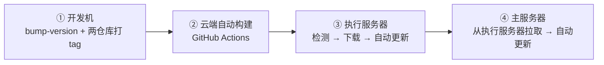
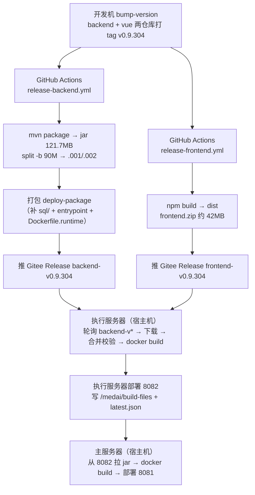
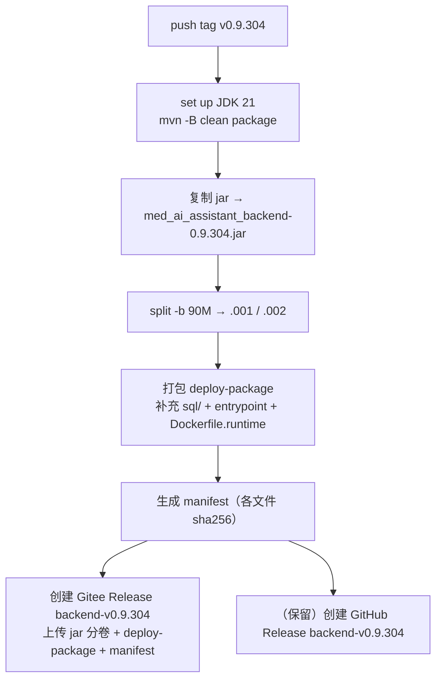
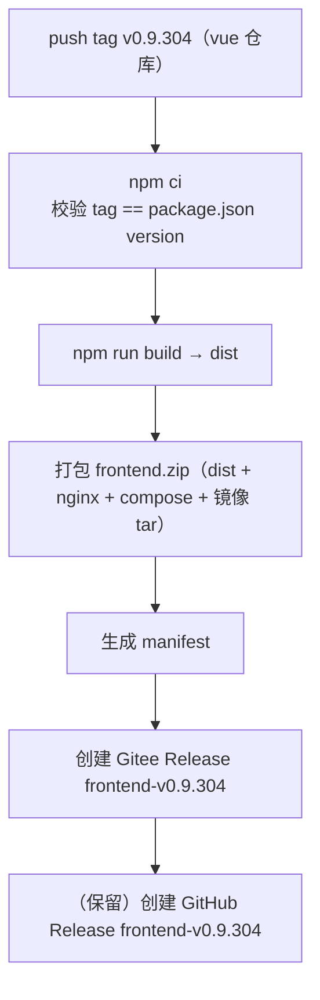
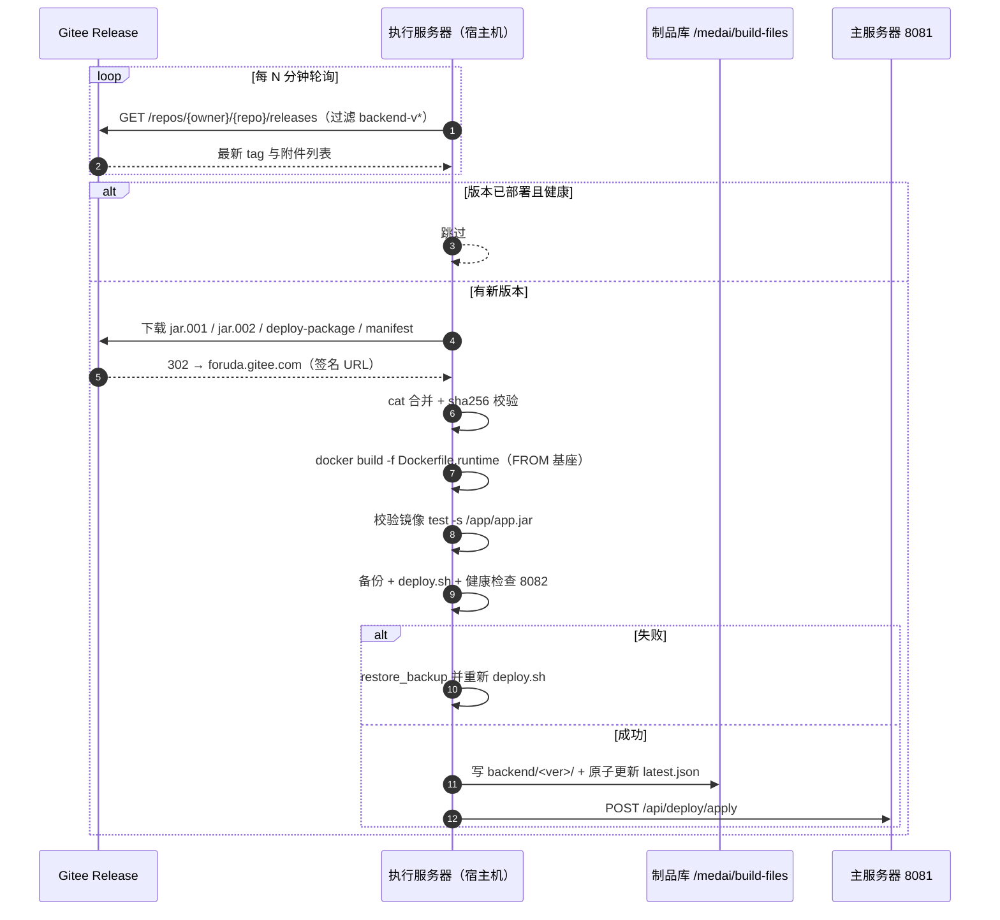
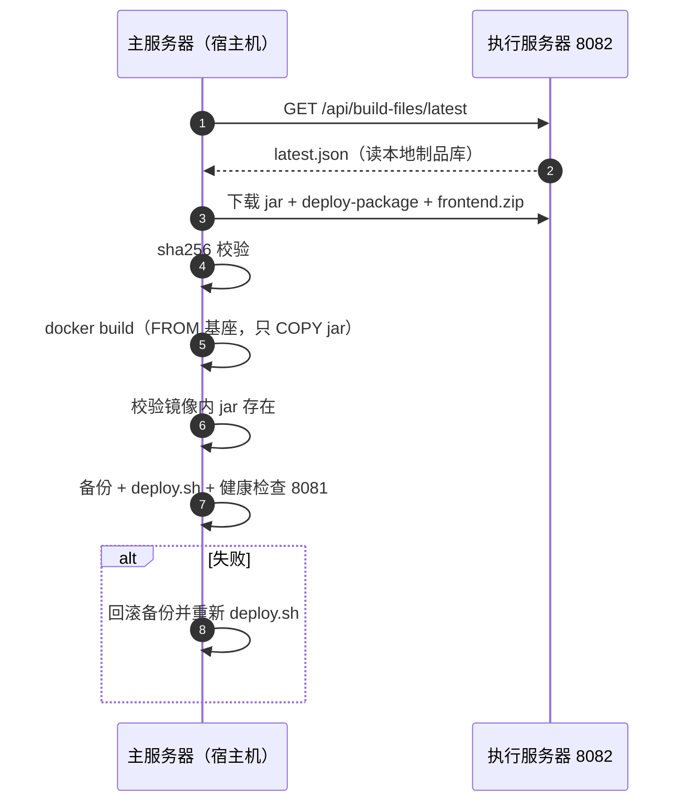

# 自动部署链路改造设计（定稿 v4）

> 状态：**代码已实施并提交**（2026-11-05）。改动：backend `da4eb1b1`、vue `d022200`、根仓库 `dad4e57`；实施与验证结果见 §十四。
> 修订：2026-11-05 经 `grill-with-docs` 审查后修订。关键修正：
> ① 发布单元改为**两个 Release**（`backend-v*` / `frontend-v*`，与现有 CI 一致，原稿错误地设计成"一个 Release 装两端"）；
> ② 前端 CI 在 **vue 仓库**（非根仓库），已有 10 次成功记录；
> ③ `runtime` 包定义为**扩展现有 deploy-package**，不新增产物概念；
> ④ tag 命名沿用 `backend-v<ver>` / `frontend-v<ver>`，与 GitHub 侧一致。
> 前序：v1（镜像 tar 分发，237MB 超限废弃）→ v2（jar 分卷）→ v3（改为 GitHub Actions）→ v4（本稿）。

---

## 一、目标

```
开发机带版本号 push → 云端自动构建 → 执行服务器检测到新构建并自动更新
→ 主服务器检测到执行服务器有新产物 → 主服务器自动更新
```



---

## 二、拓扑与硬约束

### 2.1 节点与出网能力

| 节点 | 出网能力 | 角色 |
|---|---|---|
| 开发机 | 通 GitHub、Gitee | 打 tag、构建基座镜像 |
| GitHub Actions | 通公网 | 唯一构建方 |
| 执行服务器 10.120.10.251 | **能出网（通 Gitee）** | 唯一出网点 + 制品中转：拉 Gitee 产物、落制品库、供主服务器拉取 |
| 主服务器 10.120.11.43 | **纯内网** | 只从执行服务器 8082 取制品 |

数据流单向：**GitHub Actions → Gitee → 执行服务器 → 主服务器**。唯一需打通的内网链路是「主服务器 → 执行服务器 8082」（2026-11-05 已确认放行）。

### 2.2 硬约束（全部已确认）

| 约束 | 结论 | 原因 |
|---|---|---|
| 生产不落地源码 | 禁止 `git clone/pull`、`mvn`、`npm` | 源码落到医院内网生产机有泄漏风险 |
| 交付物形态 | `jar`（编译产物）+ 运行时文件 + 前端 dist | jar 属正常交付物，2026-11-04 确认可接受 |
| 镜像构建位置 | 生产侧 `docker build`，**只 COPY jar** | 避免分发 237MB 镜像 tar |
| 部署脚本位置 | 宿主机 | 执行服务器容器内无 docker CLI，也不需要安装 |
| 测试服模式不可移植 | `git-poll-deploy.sh` 只用于测试环境 | 源码落地风险 |
| 制品分发 | jar 分卷（每卷 ≤90MB）走 Gitee Release | Gitee 单附件上限 100MB |

### 2.3 一个 jar 服务两端（审查补充，原稿未说明）

`pom.xml` 的 `main` profile 默认激活，`execution` profile 只改 `spring.profiles.active`；`docker-entrypoint.sh` 用 `--spring.profiles.active=${SPRING_PROFILES_ACTIVE:-prod}` 命令行覆盖，执行服务器 `Dockerfile.execution.linux` 里写死 `-Dspring.profiles.active=execution`。

**因此 CI 只需构建一次 jar**，主/执行服务器用同一 jar、靠启动参数切 profile——现有 `release-backend.yml` 正是这么做的（同一 jar 构建两个镜像）。

---

## 三、发布单元：两个 Release（★ 审查修正）

现有 CI 是「每个仓库一个 workflow、各自发布」：

| 仓库 | workflow | 触发 | 发布 tag | 产物 |
|---|---|---|---|---|
| `med_ai_assistant_1.0_bs_backend` | `release-backend.yml` | push tag `v*` | `backend-v<ver>` | jar、deploy-package、manifest |
| `med_ai_assistant_1.0_bs_vue` | `release-frontend.yml` | push tag `v*` | `frontend-v<ver>` | frontend.zip、manifest |

两者都发到 **GitHub** `liuzh2008/medai-builds`（私有）。改造后：**同一套产物再发一份到 Gitee**，tag 命名保持一致：

```
Gitee Release backend-v0.9.304   → jar 分卷 ×2 + deploy-package（扩展后）+ manifest
Gitee Release frontend-v0.9.304  → frontend.zip + manifest
```

**版本一致性由发布流程保证**：打 tag 时两个仓库都打同一版本号；`auto-deploy-all.sh` 现有的「backend 与 frontend 版本必须相等」校验继续生效。

> 根仓库 `med_ai_assistant_workspace` 下的 `.github/workflows/release-frontend.yml` 是**冗余副本**：根仓库无 `.gitmodules`（backend/vue 只是 gitlink）、无任何 tag、该 workflow 从未运行。改造时应删除或标注废弃，避免误用。

---

## 四、最终架构



---

## 五、制品清单与分卷

### 5.1 backend-v<ver>（Gitee Release）

| 附件 | 大小 | 说明 |
|---|---|---|
| `med_ai_assistant_backend-0.9.304.jar.001` | ~90 MB | jar 第 1 卷 |
| `med_ai_assistant_backend-0.9.304.jar.002` | ~32 MB | jar 第 2 卷 |
| `med_ai_assistant_backend-deploy-0.9.304.zip` | <1 MB | **扩展现有 deploy-package**：原内容（部署脚本、compose、config、db/migration）+ 新增 `sql/`、`docker-entrypoint*.sh`、`Dockerfile.runtime` |
| `med_ai_assistant_backend-manifest-0.9.304.json` | <1 KB | sha256 清单 |

### 5.2 frontend-v<ver>（Gitee Release）

| 附件 | 大小 |
|---|---|
| `med_ai_assistant_frontend-0.9.304.zip` | ~42 MB |
| `med_ai_assistant_frontend-manifest-0.9.304.json` | <1 KB |

### 5.3 分卷规则

- 每卷 ≤90MB（留 10MB 余量），命名 `.001`/`.002`，按序 `cat` 合并；
- 合并后**必须校验 sha256**；
- 卷数按 `split -b 90M` 动态生成，不写死。
- 现有 jar 121.7MB → 90.0 + 31.7，两卷均在限制内。

---

## 六、前置条件

### 6.1 基座镜像 `med-ai-jre-base:21`

现有两个 Dockerfile 都含 `apt-get install curl netcat-openbsd`，生产不能出网会卡死。开发机预构建基座，生产一次性 `docker load`：

```
med-ai-jre-base:21（FROM eclipse-temurin:21-jre + apt curl/netcat + TZ + 目录）
   ├─ 主服务器：FROM med-ai-jre-base:21 + COPY jar + sql + entrypoint
   └─ 执行服务器：FROM med-ai-jre-base:21 + COPY jar + entrypoint
```

实测：基座 405MB，应用镜像 648MB，离线构建 10s。

### 6.2 Dockerfile.runtime

主服务器 Dockerfile 除 jar 外还依赖 `sql/`（16 个文件）与 `deploy/main-linux-oracle/docker-entrypoint.sh`；执行服务器依赖 `deploy/execution-linux/docker-entrypoint-execution.sh`。这些随 deploy-package 分发，并配一个不联网的 `Dockerfile.runtime`。

### 6.3 凭据

| 凭据 | 用途 | 位置 |
|---|---|---|
| `BUILD_REPO_TOKEN` | 发 GitHub medai-builds | GitHub Secrets（已有） |
| `GITEE_TOKEN` | 上传 Gitee Release | GitHub Secrets（**新增**，两仓库各配） |
| `GITEE_ACCESS_TOKEN` | 执行服务器拉 Gitee Release | 执行服务器容器环境变量（已有，长度 32） |

### 6.4 制品库目录

```
/medai/build-files/
├── latest.json                                  # 原子更新（.tmp → mv）
├── base/med-ai-jre-base-21.tar                  # 基座镜像（主服务器首次部署时下载）
├── backend/<ver>/med_ai_assistant_backend-<ver>.jar
├── backend/<ver>/med_ai_assistant_backend-deploy-<ver>.zip
├── backend/<ver>/med_ai_assistant_backend-manifest-<ver>.json
└── frontend/<ver>/med_ai_assistant_frontend-<ver>.zip
```

---

## 七、完整时序

### 7.1 后端构建（release-backend.yml）



### 7.2 前端构建（release-frontend.yml，在 vue 仓库）



### 7.3 执行服务器（检测 → 下载 → 构建 → 部署）



### 7.4 主服务器（从执行服务器拉取 → 构建 → 部署）



---

## 八、代码改动清单

| 层 | 改动 | 说明 |
|---|---|---|
| **CI（后端）** | 改造 `release-backend.yml` | 增加 `split -b 90M`；deploy-package 补充 `sql/`、`docker-entrypoint*.sh`、`Dockerfile.runtime`；增加 Gitee Release 上传（`GITEE_TOKEN`） |
| **CI（前端）** | 改造 `med_ai_assistant_1.0_bs_vue/.github/workflows/release-frontend.yml` | 增加 Gitee Release 上传；产物无需分卷（42MB） |
| **CI（清理）** | 删除根仓库 `.github/workflows/release-frontend.yml` | 冗余副本，根仓库无 .gitmodules、无 tag、从未运行 |
| **执行服务器** | 新增 `gitee-pull-release.sh`（或改造 `auto-deploy-execution.sh`） | 轮询 Gitee → 下载分卷（整卷重下）→ 合并校验 → build → 写制品库 → deploy |
| **执行服务器** | 新增 `Dockerfile.runtime` | `FROM med-ai-jre-base:21`，只 COPY jar + 运行时文件，不联网 |
| **主服务器** | 改造 `auto-deploy-backend.sh` | 从 `8082/api/build-files` 下载 jar（不再下载镜像 tar）→ 本地 build → deploy |
| **Java** | `BuildFileController` 增加通用制品下载端点 | `GET /api/build-files/artifact/{type}/{version}/{filename}`，白名单防穿越 |
| **Java** | `BuildFileController.getLatestVersions()` | 优先读本地 `latest.json`，读不到再走旧 Release 查询 |
| **Java** | `GitHubReleaseClient.downloadRelease()` | 补「本地已存在即返回」分支（**当前只有查 API，注释写了缓存但没实现**） |
| **Java** | `GitHubReleaseClient.downloadExecutionRelease()` | tag 与缓存目录解耦（当前用 `backend-v` tag 却按 `execution-v` 取目录，产物会落到 `execution/backend-v<ver>/`） |
| **基础设施** | 基座镜像 | 开发机构建 → 执行服务器入库 → 主服务器经 8082 下载 load |

---

## 九、失败模式与回滚

| 场景 | 处理 |
|---|---|
| Gitee 附件下载中断 | **整卷重下**（不支持 Range，不能 `curl -C -`）；下载到 `.part`，校验 sha256，失败删除重试 |
| 分卷缺失/校验失败 | 丢弃重下，不触碰现有部署 |
| `docker build` 失败 | 保留旧镜像，不切换容器 |
| 镜像内 jar 缺失（COPY 写错） | 构建后强制 `test -s /app/app.jar`，失败即中止 |
| 健康检查失败 | 回滚备份目录并重新 deploy |
| Gitee 不可达 | 本轮跳过，下轮重试；连续 N 次告警 |
| 基座镜像缺失 | build 前 `docker image inspect med-ai-jre-base:21`，缺失则中止 |
| 前后端版本不一致 | `auto-deploy-all.sh` 直接退出，两端都不部署 |

---

## 十、决策记录

| 决策项 | 结论 | 日期 |
|---|---|---|
| 构建侧 | GitHub Actions（Gitee Go JDK ≤17 不可用） | 2026-11-04 |
| 发布单元 | **两个 Release**：`backend-v<ver>` / `frontend-v<ver>` | 2026-11-05（审查修正） |
| tag 命名 | 沿用现有 `backend-v<ver>` / `frontend-v<ver>` | 2026-11-05 |
| 制品形态 | jar 分 2 卷，不分发镜像 tar | 2026-11-04 |
| 生产侧构建 | 允许 `docker build`，只 COPY jar | 2026-11-04 |
| 源码落地 | 生产禁止 git pull / mvn / npm | 2026-11-04 |
| jar 合规 | 可接受 | 2026-11-04 |
| 脚本位置 | 宿主机 | 2026-11-04 |
| 网络拓扑 | 执行服务器出网、主服务器纯内网 | 2026-11-04 |
| 主→执行 8082 | 已放行 | 2026-11-05 |

---

## 十一、验证结果

| # | 验证项 | 结果 | 日期 |
|---|---|---|---|
| 1 | GitHub Actions 后端构建 | ✅ v0.9.294/295 全流程 success | 2026-11-05 |
| 2 | GitHub Actions 前端构建 | ✅ v0.9.179~206 共 10 次 success | 2026-11-05 |
| 3 | 生产离线构建（`--network=none` + 基座） | ✅ 10s 成功，镜像 648MB | 2026-11-04 |
| 4 | Gitee 90MB 分卷上传 | ✅ 18s（5.24MB/s），HTTP 201 | 2026-11-05 |
| 5 | Gitee 下载 / Range | ⚠️ 必须走 API 端点；**不支持 Range** | 2026-11-05 |
| 6 | 主服务器 → 执行服务器 8082 | ✅ 已放行 | 2026-11-05 |

---

## 十二、实施顺序

1. **恢复发布流水线**：确认两个仓库都能打 tag（当前 backend 到 v0.9.295、vue 到 v0.9.206，0.9.207+ 从未走 CI）；
2. **改后端 CI**：`split` + deploy-package 扩展 + Gitee 上传，打测试 tag 验证产物；
3. **改前端 CI**：加 Gitee 上传；
4. **基座镜像**：开发机构建 → 导入执行服务器 → 主服务器经 8082 下载 load；
5. **执行服务器**：`gitee-pull-release.sh`（轮询 + 下载 + 合并校验 + build + 部署 + 写制品库）；
6. **主服务器**：改造 `auto-deploy-backend.sh`（拉 jar + build + 部署）；
7. **联调**：测试服先跑通，再切生产。

---

## 十三、附录：实测与现状记录

### 13.1 离线构建（2026-11-04，测试服）

| 项 | 结果 |
|---|---|
| 基座镜像（联网一次） | ✅ 405MB |
| 离线构建 `--network=none` | ✅ 10s，镜像 648MB |
| 镜像内 jar / JRE / curl | ✅ 122MB / Temurin 21.0.10 / 8.5.0 |
| 启动冒烟 | ⚠️ 缺 `config/application-patient-status-filter.properties`（预期） |

**三条硬约束**：Dockerfile.runtime 内禁止联网 RUN；`COPY` 目标写错不报错（必须 `test -s /app/app.jar`）；config 必须随包。

### 13.2 Gitee 上传/下载（2026-11-05，手工验证）

| 项 | 结果 |
|---|---|
| 90MB 上传 | ✅ 201，18.0s，5.24MB/s |
| 32MB 上传 | ✅ 201，6.5s |
| 创建 Release | `body` 必填 |
| `browser_download_url` | ❌ 403（私有仓库） |
| API 下载端点 | ✅ 302 → foruda.gitee.com |
| Range 请求 | ❌ 200 + 全量（不支持） |
| 完整下载 32MB | 16.2s，2.07MB/s |

**实现约束**：下载走 API 端点（`asset_id` 从 `/releases/{id}/attach_files` 取）；不能依赖续传，整卷重下；超时设 300s 以上。

### 13.3 CI 现状（2026-11-05 核查）

| 仓库 | workflow | 最近运行 | 结论 |
|---|---|---|---|
| backend | Release Backend | v0.9.295（2026-09-08）success | ✅ 可构建 JDK 21 |
| vue | Release Frontend | v0.9.206（2026-07-20）success | ✅ 可构建前端 |
| 根仓库 | Release Frontend（冗余副本） | 无任何运行 | ❌ 应删除 |

tag 现状：backend 最新 `v0.9.295`、vue 最新 `v0.9.206`，当前 `VERSION=0.9.303` —— **0.9.207 之后从未走 CI**，全部本地构建手工部署。

### 13.4 grill-with-docs 审查修正项

| 原稿主张 | 实际 | 修正 |
|---|---|---|
| 一次 tag 产出前后端并放进同一 Release | 前后端是不同仓库、不同 workflow、各自 tag | 改为两个 Release |
| 前端构建在 `release-backend.yml` 流程里 | 前端 CI 在 vue 仓库 | 拆分说明 |
| 现有 CI「只缺 split 与上传 Gitee」 | 还缺 deploy-package 扩展、前端 Gitee 上传、根仓库副本清理 | 补全清单 |
| tag 名 `v0.9.304` | 现有为 `backend-v*` / `frontend-v*` | 沿用现有命名 |
| runtime.zip 为新产物 | 现有已有 deploy-package，只缺 sql/entrypoint/Dockerfile.runtime | 改为扩展 deploy-package |

## 十四、实施与验证结果（2026-11-05）

### 14.1 已完成改动

| 层 | 文件 | 状态 |
|---|---|---|
| 后端 CI | `.github/workflows/release-backend.yml` | ✅ jar 分卷（90MB）、deploy-package 扩展、Gitee 发布、manifest 含 jarParts |
| 后端 CI 脚本 | `.github/scripts/publish-gitee-release.sh` | ✅ 通用发布（只传分卷/zip/json，避开 100MB 限制） |
| 前端 CI | `med_ai_assistant_1.0_bs_vue/.github/workflows/release-frontend.yml` | ✅ 增加 Gitee 发布 |
| 基座镜像 | `deploy/base/Dockerfile.jre-base` + `build-base-image.sh` | ✅ 构建/导出脚本 |
| 运行时镜像 | `deploy/main-linux-oracle/Dockerfile.runtime`、`deploy/execution-linux/Dockerfile.runtime` | ✅ 只 COPY，禁联网 RUN |
| 执行服务器 | `deploy/execution-linux/gitee-pull-release.sh` | ✅ 轮询→下载→合并校验→离线构建→部署→制品库→回滚 |
| 主服务器 | `deploy/main-linux-oracle/auto-deploy-backend.sh` | ✅ 改为拉 jar + 本地构建；回滚用制品库旧 jar 重建 |
| Java | `BuildFileController` / `GitHubReleaseClient` / `DeployArtifactNames` / 测试 | ✅ 与 `github.release.enabled` 解耦、本地制品端点、防穿越、本地短路 |
| 配置 | `deploy/execution-linux/config/execution/application-execution.properties` | ✅ 新增 `github.release.cache-dir=/medai/build-files` |

### 14.2 联调验证（测试服 100.66.1.4）

| 验证项 | 结果 |
|---|---|
| Gitee 分卷上传（90MB + 32MB + zip + manifest） | ✅ 4 个附件，约 18s |
| 执行服务器拉取 + cat 合并 + sha256 | ✅ 127,760,971 字节校验通过 |
| 离线构建执行服务器镜像（`--network=none`） | ✅ 成功，镜像 648MB，镜像内 jar 校验通过 |
| 制品库 + `latest.json` 原子写 | ✅ 内容正确 |
| `/api/build-files/latest` | ✅ 返回 latest.json（`github.release.enabled=false` 下仍可用） |
| `/api/build-files/artifact/**` | ✅ 返回文件；路径穿越 400 |
| 主服务器链路（`/api/deploy/latest` → 8082 → 构建） | ✅ 下载+校验+构建 405MB 镜像 |

### 14.3 未完成项（需在生产执行）

1. 真实 tag 触发 CI（push 代码 + 打 tag `v0.9.304` 到两个仓库）；
2. 两个仓库配置 GitHub Secrets `GITEE_TOKEN`；
3. 基座镜像导入生产（执行服务器先 `docker load`，主服务器经 8082 下载导入）；
4. 生产执行服务器升级到含新 Java 的镜像，再启用 `gitee-pull-release.sh` 定时任务；
5. 旧 `auto-deploy-execution.sh`（GitHub Release 版）保留，新链路稳定后停用。

### 14.4 上线步骤

1. 配置 `GITEE_TOKEN` secret；
2. 打 tag `v0.9.304`（backend + vue），确认 Actions 成功、Gitee Release 有附件；
3. 执行服务器：导入基座镜像 → 更新 config → 部署新镜像 → `DRY_RUN=true` 跑 `gitee-pull-release.sh` → 正式跑；
4. 主服务器：导入基座镜像 → `DEPLOY_ALLOW_OUTSIDE_WINDOW=true` 跑一次 `auto-deploy-backend.sh`；
5. 三端版本一致后启用 systemd timer。

## 十五、开发机发布通道（2026-11-05 实测补充）

### 15.1 背景：Actions 到 Gitee 不可靠

`v0.9.304` 实测两次：

| 运行 | 结果 |
|---|---|
| 前端 `Release Frontend` | ✅ success（42MB zip 上传成功） |
| 后端 `Release Backend` 第 1 次 | ❌ `Could not resolve host: gitee.com`（第 1 卷成功后 DNS 失败） |
| 后端 `Release Backend` 第 2 次 | ❌ 卡在 90MB 上传 20 分钟，手动取消 |

结论：GitHub Actions runner 到 Gitee 的网络不可控，**不能把 Gitee 发布作为唯一通道**。

### 15.2 方案：`scripts/publish-release.ps1`

开发机本地完成与 CI 完全一致的产物生成与发布：

1. `mvn package`（目标 jar 不存在时）；
2. jar 分卷 90MB（`.jar.001` / `.jar.002`）；
3. deploy-package（脚本 + compose + config + sql + migration + 两个 Dockerfile.runtime），用 .NET `ZipFile` 手动写条目，**保证正斜杠**；
4. manifest（sha256）；
5. Gitee token 通过 `ssh testserver "docker exec ... printenv GITEE_ACCESS_TOKEN"` 获取，**不落盘**；
6. 创建/更新 Gitee Release 并上传，每个附件 4 次重试。

### 15.3 实测结果（v0.9.304）

| 项 | 结果 |
|---|---|
| 分卷 | 90.0 MB + 31.8 MB |
| deploy-package | 41.5 KB，32 个条目，**0 个反斜杠** |
| 上传 | 4 个附件全部成功（90+31.8+zip+manifest） |
| Gitee Release | `backend-v0.9.304`（4 个产物 + Gitee 自动生成的 2 个源码包） |

### 15.4 与 CI 的分工

- CI 继续负责构建并发 GitHub `medai-builds`（归档，GitHub 侧稳定）；
- Gitee 发布步骤加 `continue-on-error: true` + `timeout-minutes: 10`，失败/超时不再拖垮整个 job；
- Gitee 产物缺失时，用本脚本补传（格式与 CI 一致，执行服务器无感知）。

### 15.5 用法

```powershell
.\scripts\publish-release.ps1                    # 使用 VERSION 文件中的版本
.\scripts\publish-release.ps1 -Version 0.9.304
.\scripts\publish-release.ps1 -SkipBuild         # jar 已存在时跳过 mvn
```

## 十六、一条命令发两端（2026-11-05）

### 16.1 命令

```powershell
.\scripts\publish-release.ps1                          # 前后端都发（默认 all）
.\scripts\publish-release.ps1 -Component backend       # 只发后端
.\scripts\publish-release.ps1 -Component frontend      # 只发前端
.\scripts\publish-release.ps1 -ForceBuild              # 强制重新构建
```

脚本按 `VERSION` 自动取版本，产物分别发布到：

| 组件 | Gitee 仓库 | Tag |
|---|---|---|
| 后端 | `chengdu-qingzhou_0/med_ai_assistant_1.0_bs_backend` | `backend-v<ver>` |
| 前端 | `chengdu-qingzhou_0/med_ai_assistant_1.0_bs_vue` | `frontend-v<ver>` |

### 16.2 前端包内容与大小

| 情况 | 包大小 | 内容 |
|---|---|---|
| 本机 Docker 可用 | ~42MB | dist + 配置 + 脚本 + **medai-images.tar**（前端镜像 + nginx 基础镜像） |
| 本机 Docker 不可用（默认） | ~9MB | dist + 配置 + 脚本；部署时 `deploy-linux.sh` 走 `--build` 分支 |

> `deploy-linux.sh` 逻辑：有 `medai-images.tar` → `docker load` + `--no-build`；没有 → `compose up --build`（Dockerfile 只 COPY dist，不依赖源码）。  
> 因此无镜像 tar 的前提是**生产已有 `nginx:1.25-alpine` 基础镜像**（历史部署已存在）。

### 16.3 实测（v0.9.304）

| 组件 | 结果 |
|---|---|
| 后端 | `backend-v0.9.304`：jar.001(90MB) + jar.002(31.8MB) + deploy.zip(41.5KB) + manifest |
| 前端 | `frontend-v0.9.304`：frontend.zip(8.9MB, 344 条目, 0 反斜杠) + manifest |
| 包结构校验 | dist/index.html、Dockerfile、docker-compose.yml、nginx.conf、deploy-linux.sh 均存在 |

### 16.4 注意

- 脚本为 **UTF-8 with BOM**（PowerShell 5.1 解析中文必需，与 `bump-version.ps1` 一致）；
- Gitee 单附件 100MB：前端 42MB、后端起分卷，均在限制内；
- 前端若要用离线镜像，先启动 Docker Desktop，再 `-Component frontend -ForceBuild`。
