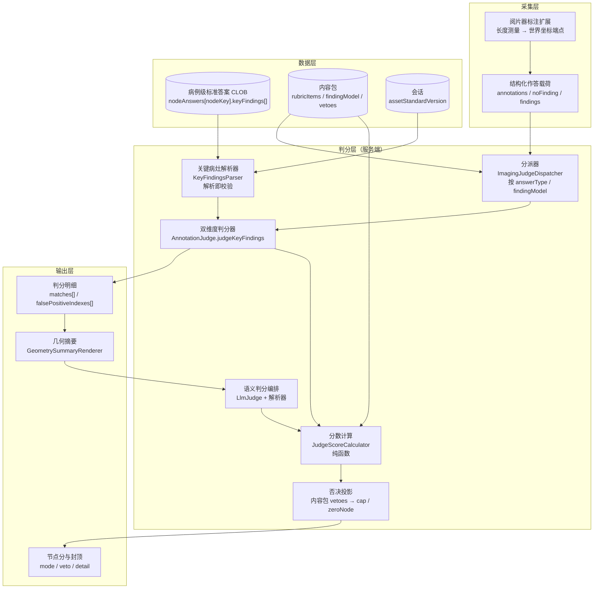
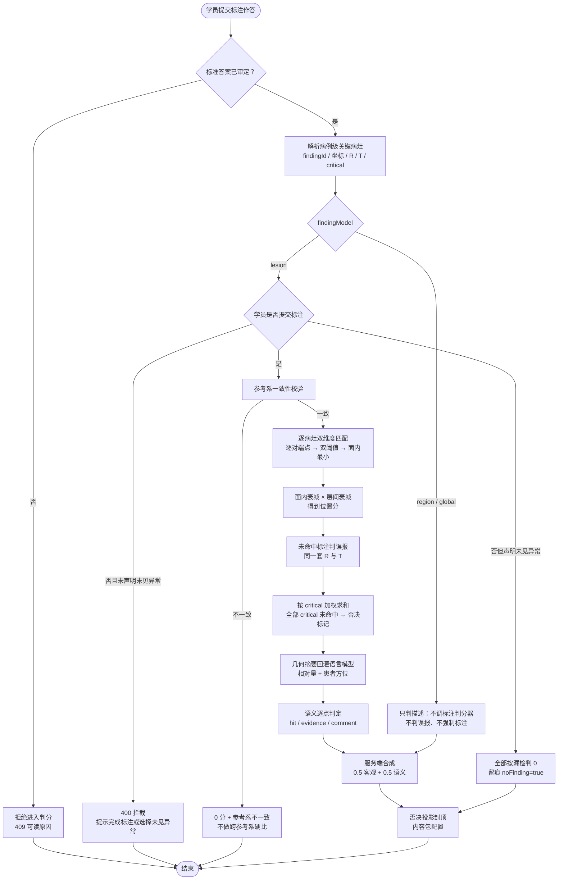
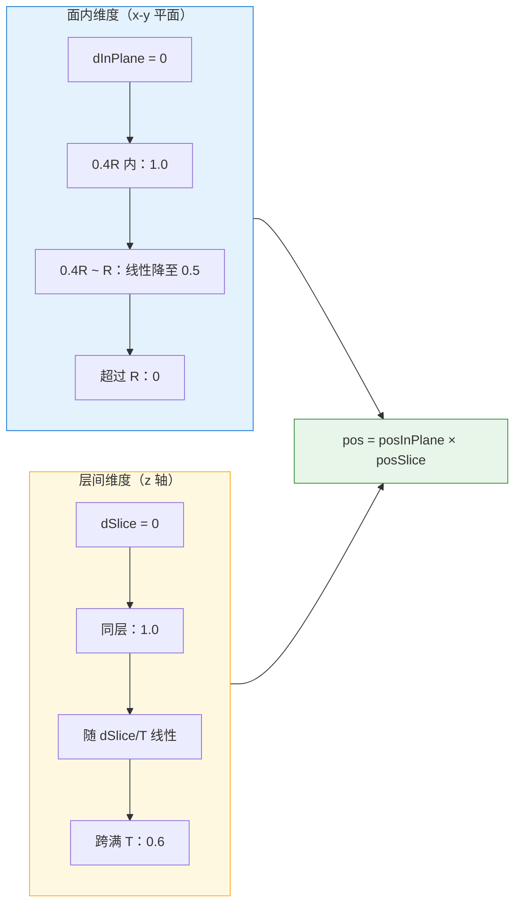
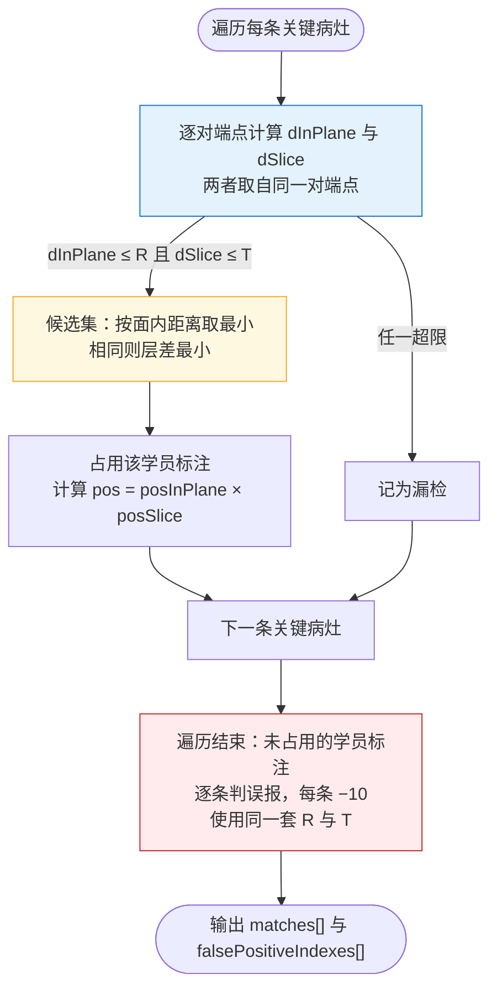
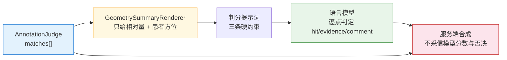
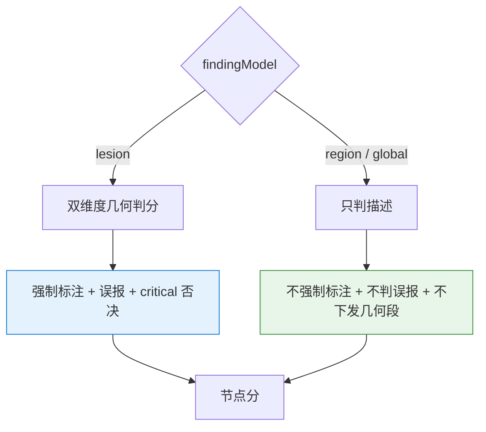

# 专利申请技术交底书

## 一、发明名称

一种基于面内与层间双维度几何比对及语义自洽约束的医学影像标注判分方法及系统

---

## 二、技术领域

本发明属于医学影像教学与计算机数据处理交叉技术领域，具体涉及一种对医学影像阅片训练中学员标注进行自动判分的方法及系统。本发明以 DICOM 患者坐标系下的三维端点坐标为判分基准，将标注偏差分解为面内偏差与层间偏差两个独立维度分别计算得分，并将几何判分结果以相对量形式回灌语言模型、约束其只做描述与几何的自洽性判定而不重复判定位置，形成客观几何判分与语义判分协同的标注判分链路。

---

## 三、背景技术

### 3.1 现有技术概述

医学影像阅片训练的核心环节是"学员在影像上标出病灶，系统判断标得对不对"。现有方案大致分为三类。

**第一类：轮廓重合度判分。** 学员在影像上勾画病灶轮廓，系统计算其与金标准轮廓的重合度（如交并比、Dice 系数），重合度超过设定阈值即判正确，再叠加标签对错的判断汇总为分数。这类方案的问题在于：其一，要求学员勾画闭合轮廓，而临床读片教学中最常用的操作是长度测量（画一条长径线），轮廓勾画对学员是额外负担，与真实工作流不符；其二，重合度是一个把三维偏差压扁成单值的标量，无法回答"学员是面内没找准，还是层选错了"；其三，单一阈值仍是二值判定，阈值边界附近没有区分度。

**第二类：报告文本比对判分。** 教师提供标准化读片报告作为标准答案，学员提交练习报告，系统对两份报告做文本级比对并给出得分。这类方案完全没有利用影像的空间信息，学员在报告里写"右上肺结节"但标注落在左肺，只要文字对得上仍可得分；反过来，标注准确但表述朴素的学员会被压低分数。

**第三类：标注质量评估。** 面向人工智能训练数据的标注生产，按图像复杂度与标注任务复杂度分级，从准确性、完整性、一致性、效率等维度给标注结果打质量分，再按质量分决定人工审核策略。这类方案评的是"标注数据能不能用于训练模型"，不是"学员有没有学会看片"，其判据不包含教学目标，也不产出面向学员的反馈。

上述三类方案在工程实现上还有四个共同缺陷。

| 缺陷 | 具体表现 | 后果 |
|---|---|---|
| 偏差维度不可分离 | 用三维欧氏距离或轮廓重合度把面内偏移与层间偏移合成一个数 | "面内偏 4mm、层差 4mm"与"面内偏 0、层差 5.7mm"被判成同一档，而前者是位置没找准、后者是层选错，教学反馈完全不同 |
| 阈值边界断崖 | 命中判定为二值：容差内满分、容差外零分 | 差 0.1mm 与差 4.9mm 同分，差 5.1mm 与差 50mm 同分；人工点击本就有 1–3mm 固有误差，边界附近的判定不稳定 |
| 误报与命中阈值不一致 | 命中用一个半径、误报用另一个半径 | 出现"面内偏 9mm 而层对"既不命中也不误报的分数空洞，或"层差 10 层而面内 2mm"同时算命中又算误报 |
| 主次病灶同权 | 漏掉主病灶与漏掉次要结节扣同样的分 | 与临床教学中"先保证不遗漏主要病变"的安全要求不符，也无法触发否决 |

此外，当引入语言模型对学员的文字描述做语义判分时，又出现两类新问题：语言模型直接给出总分，分数不可复现、不可审计；客观几何判分与语义判分各自独立运行，出现"标注偏 40mm 但描述写得漂亮仍得高分"，或者"位置分已经扣过、语义判分又因同一处偏差再扣一次"。

### 3.2 引用文献

[1] 中华医学会放射学分会. 医学影像学教学指南（试行）.

[2] 国家卫生健康委员会. 住院医师规范化培训内容与标准（2022 年版）.

[3] Litjens G, Kooi T, Bejnordi BE, et al. A survey on deep learning in medical image analysis. Medical Image Analysis. 2017;42:60-88.

[4] Zheng Q, Yang H, et al. Accuracy of radiologists and large language models in radiology reporting: a systematic review. European Radiology. 2024.

[5] Singhal K, Azizi S, Tu T, et al. Large Language Models Encode Clinical Knowledge. Nature. 2023;620:172-180.

[6] 周诚, 等. 医学影像标注质量控制与评价方法研究进展. 中国医学影像技术. 2023.

---

## 四、发明内容

### 4.1 要解决的技术问题

本申请实施例的主要目的在于提供一种医学影像标注判分方法，解决现有标注判分方案中偏差维度不可分离、阈值边界断崖、误报判定不对称、主次病灶同权，以及引入语言模型后分数不可复现与几何—语义重复惩罚的问题。

具体分解为五个技术问题，按重要性排序：

**问题一：如何把一次标注偏差拆成"面内没找准"与"层选错"两个可分别计分的维度。** 现有方案用三维距离或轮廓重合度合成单值，教学上无法据此给出不同反馈；且轮廓重合度依赖闭合轮廓，与长度测量这一真实阅片操作不兼容。

**问题二：如何在容差边界附近保持评分的连续性与稳定性。** 二值命中使分数在阈值处跳变，而人工点击存在固有误差，导致同一水平的学员因 0.1mm 之差得到完全不同的分数。

**问题三：如何保证命中判定与误报判定使用同一套空间判据。** 两套判据会产生分数空洞或重复计数，使分数无法解释。

**问题四：如何让关键病灶的遗漏产生可配置的否决后果，而不是与次要病灶等权扣分。**

**问题五：如何让语言模型只做"描述与几何是否自洽"的判定，而不重复判定位置、不直接产出总分。** 现有做法把整段描述连同坐标一起交给模型打分，模型既可能被漂亮文字带偏，也可能对已经扣过的位置错误再扣一次；模型自报的分数不可复现，无法用于正式考核。

### 4.2 技术方案

本发明提出一种**基于面内与层间双维度几何比对及语义自洽约束的医学影像标注判分方法**。方法的核心在于：以病例级关键病灶的三维端点坐标为唯一真值，把学员标注与标准标注的偏差分解为面内距离与层间距离，两者取自同一对端点，分别经两段衰减函数映射为面内得分与层间得分，以乘积作为该病灶的位置得分；命中与误报共用同一套双阈值；关键病灶按关键性标记加权，全部未命中时产出否决标记并由内容包配置封顶；在此客观判分之上，把已算出的几何事实以相对量形式渲染为文本段回灌语言模型，并约束模型只判定描述与几何的自洽性、不得重复判定位置、不得产出总分与否决，最终由服务端按权重合成节点分。

#### 4.2.1 系统总体架构



#### 4.2.2 判分总流程



#### 4.2.3 方法步骤

**S1：建立病例级关键病灶数据对象。**

以病例为单位（而非病种为单位）建立标准标注集合。每条关键病灶包含：病例内唯一的标识 `findingId`；标签 `label`，取值受内容包标签集合约束；关键性标记 `critical`；面内容差 `hitRadiusMm`；允许层差 `maxSliceDiff`（以层数计）；病灶长径 `sizeMm`；解剖位置 `location`；几何锚点 `annotation`，其中包含世界坐标端点数组 `points`、测量长度 `lengthMm`、定位切片 `sopInstanceUID`、参考坐标系 `frameOfReferenceUID`；来源标记 `source`。

面内容差与允许层差支持两级取值：病灶级优先，未设置或非正数时回落到资产级默认值。该设计的原因在于：内容包是病种级配置，同一病种下 3mm 结节与 30mm 肿块用同一个容差没有意义，容差必须能落到具体病灶。

标准标注集合随标准答案一同审定、冻结版本。训练会话在创建时记录当时使用的标准答案版本号，会话内判分按该版本号读取，后续修订不影响在跑会话。读取历史版本时不筛选"当前有效"状态，以保证已提交作答的判分基准不随时间漂移。

**S2：接收学员标注作答。**

学员在阅片器中完成长度测量后，标注扩展采集测量的世界坐标端点、标签、长度、定位切片与参考坐标系，回传后随作答载荷一并提交。作答载荷另设一个显式的"未见异常"布尔标记，用于区分"学员判断该影像正常"与"学员忘记标注"。

**S3：前置校验与分支处理。**

若标准答案未审定，拒绝进入判分并返回可读原因，不产生"静默 0 分"。若病例的发现模型为区域型或全局型（肺炎、脑梗等没有唯一坐标的病变），转入只判描述的分支：不调用标注判分器、不产生误报、不强制要求标注。若为定位型且学员未提交标注：未勾选"未见异常"则按漏做拦截，提示完成标注或选择未见异常；勾选了则按全部漏检判 0 分并留痕。

若标准侧与学员侧的参考坐标系不一致，直接判 0 分并输出"参考系不一致"，不计算距离——跨参考系的坐标距离没有物理意义，硬算会得到看似合理实则错误的分数。学员侧缺失参考坐标系时放行，但在判分明细中留痕，供事后排查。

**S4：计算双维度距离。**

对每条关键病灶，遍历其端点与每条未占用学员标注的端点，对每一对端点分别计算：

```
dx = qx − px
dy = qy − py
dz = pz − qz
dInPlane = sqrt(dx² + dy²)
dSlice   = |dz|
```

其中 (px,py,pz) 为标准端点，(qx,qy,qz) 为学员端点。面内距离只取 x、y 分量，层间距离只取 z 分量。

**面内距离与层间距离必须取自同一对端点。** 若允许分别取最优，会出现"面内距离由 A 对端点决定、层差由 B 对端点决定"的拼接判定，把两组本不相关的偏差组合成一个不存在的"命中"。

实现上直接对标准端点与学员端点逐对计算上述两个距离，不引入三维距离作为中间量。原因是一旦用三维距离筛选候选，就会出现"三维距离落在容差内、但层差已超限"的候选被选中，把真正合格的另一条挤掉；逐对计算两个维度再从同一对端点取值，可以从源头避免这种拼接。

**S5：双阈值命中判定与匹配。**

命中条件为：`dInPlane ≤ R 且 dSlice ≤ T`，其中 `T = maxSliceDiff × 层厚`。任一超限即未命中。

匹配顺序为：先按双阈值筛出候选集；在候选集中按面内距离取最小；面内距离相同时取层差最小；每条学员标注只能被一条关键病灶占用。遍历结束后仍未被占用的学员标注，逐条记为误报。

**S6：计算位置得分。**

命中的关键病灶按两个维度分别衰减，再取乘积：

```
posInPlane = 1.0                                    dInPlane ≤ 0.4R
           = 1.0 − 0.5 × (dInPlane − 0.4R) / 0.6R   0.4R < dInPlane ≤ R
           = 0                                      dInPlane > R

posSlice   = 1.0 − 0.4 × (dSlice / T)               0 ≤ dSlice ≤ T

pos = posInPlane × posSlice
```

设计要点：

- `0.4R` 以内给满分，承认人工点击必然存在 1–3mm 误差；
- 面内超过 `R` 直接归零（硬门槛），因为面内都没对准意味着没有找到病灶；
- 层间只惩罚不否决，跨满 `T` 仍保留 0.6，因为"滚层没停准"与"没找到病灶"是两类不同错误；
- 两个维度的语义不同，因此用乘积而非加权和：任一维度归零，位置分即归零。

**S7：误报判定。**

学员标注与所有关键病灶的双阈值均不满足时判为误报，每条扣 10 分。误报必须与命中使用**同一套 R 与 T**：若误报用更小的半径，会出现"面内偏 9mm 而层对"既不命中也不误报的分数空洞；若误报用更大的半径，会出现同一条标注既命中又误报的重复计数。

**S8：加权与节点位置分。**

关键病灶的位置分按关键性标记加权求和：

```
positionScore = Σ(w_i × pos_i) / Σ(w_i)
w_i = critical ? 2.0 : 1.0
```

可选的次要病灶进入分母但权重减半，漏掉只影响分数、不触发否决，避免"标不全就不可判"。

**S9：关键病灶否决。**

当所有 `critical=true` 的关键病灶位置分均为 0 时，产出否决标记 `MISSED_PRIMARY_FINDING`。否决的后果不在代码中写死，而是由内容包的否决配置投影：`zeroNode` 决定是否把该节点清零，`cap` 决定总分封顶值。这样同一套判分器可以适配不同病种的教学要求，而不需要改代码。

**S10：语义判分（逐点判定）。**

将病例资料、节点题干、标准答案要点、内容包评分点、学员作答文本、标注摘要组装为判分上下文，调用语言模型。模型只输出点级判定数组，每一项包含评分点标识、命中程度（完整/部分/未命中）、学员原句证据、简短评语；另可输出一句针对本答案的追问、若干条自洽性提示与一个置信度。

模型输出受两条硬规则约束：

- 模型返回的评分点标识必须属于内容包该节点的评分点集合，不属于者一律丢弃并记录，防止模型自造评分点抬高分数；
- 内容包有、模型未返回的评分点，按"未命中"计分并记入缺失清单，不得默认命中。

**模型不产出总分，也不产出否决。** 总分由服务端按权重公式计算；否决只由规则层产出。原因是否决是"一票定生死"的判定，必须可复现、可审计，交给模型会出现同一答案这次封顶、下次不封。

**S11：几何结果回灌与语义约束。**

将客观判分已算出的逐条匹配结果渲染为语言模型可读的几何段，随判分上下文下发。几何段只给相对量，不给标准坐标绝对值：

- 每条标准病灶的命中状态（命中/漏检）；
- 命中时的面内偏移量（毫米）、层差（层数）、长度差及是否超容差；
- 偏移方向使用患者解剖方位（+x 为患者左、+y 为患者后），不使用"图像上下左右"——患者俯卧时二者相反；
- 方位分量需超过 `max(3mm, 20% × 面内距离)` 才计入，最多取两个分量，避免"基本重合"却报出一串方位；
- 漏检时给出最近一次尝试的面内偏移与层差，供模型判断学员"是不是看错了地方"。

同时在提示词中写入三条硬约束：

1. **只引用不改写**：距离与方位是系统算出的事实，模型不得重算、改写或否定；
2. **不重复判位置**：位置分已由客观判分扣除，模型只判"描述与几何是否自洽"；
3. **反向保护**：学员描述完全未涉及位置时，不得因几何偏差扣减描述分——否则与客观分重复惩罚。

几何段不包含标准坐标绝对值，避免把标准答案的空间信息以模型可复现的形式泄露；几何段为空（区域型病例或无标注）时不下发该段，避免模型追问缺失的几何信息或臆造距离。

**S12：节点分合成与降级。**

标注节点的节点分为客观分与语义分各占一半：

```
nodeScore = round(0.5 × objectiveScore + 0.5 × semanticScore)
```

否决只认客观侧：即使模型侧返回了否决标记，也一律丢弃。

语言模型不可用（模板缺失、调用失败、超时、响应解析失败、评分点为空）时，降级为规则判分，节点分取客观分，并在明细中标记降级模式；不重试（避免放大延迟与计费），不把失败当作 0 分（模型抖动不得记成学员答错）。

**S13：发现模型分流。**

按内容包的发现模型字段在两种判分模式间切换：

| 模式 | 触发 | 判分方式 | 强制标注 | 误报 |
|---|---|---|---|---|
| 定位型 `lesion` | 有病例级关键病灶 | 双维度几何 + 描述 + 自洽性 | 是 | 有 |
| 区域型/全局型 `region`/`global` | 无唯一坐标的病变 | 只判描述 | 否 | 无 |

区域型病例下学员画了标注，不判误报、不扣分，仅在报告中记录"额外标注 N 条（未参与判分）"；该模式下不向模型下发几何段。

**S14：层厚与容差来源约束。**

层厚只从内容包的节点配置读取，节点配置缺失时取预设默认值，**不读取学员在参数节点填写的层厚**。若让被考核者填写的参数决定容差，学员填 10 就全命中、填 0.1 就全漏检，判分尺度被交到了被考核者手里。

**S15：判分明细与可追溯字段。**

判分明细中固定写入：标准病灶总数、命中数、误报数及其下标、标签匹配数、位置分、面内容差、允许层差、层厚、逐条匹配结果（病灶标识、是否命中、面内偏移、层差、位置分、标签是否正确、长度差、方位）、判分模式、降级原因、标准答案版本来源。这些字段是判分可解释、可抽检、可回归的证据链。

---

## 五、附图说明

### 图1：系统总体架构图

（见 4.2.1 节，展示采集层、数据层、判分层、输出层的组件与调用关系。）

### 图2：判分总流程图

（见 4.2.2 节，展示从提交到封顶的完整分支，含标准答案门禁、发现模型分流、参考系校验、未见异常分支与降级路径。）

### 图3：双维度几何与衰减曲线图



### 图4：匹配与误报判定流程图



### 图5：几何结果回灌与语义约束示意图



### 图6：发现模型分流示意图



---

## 六、具体实施方式

### 6.1 实施环境

| 组件 | 技术选型 |
|---|---|
| 后端 | Java 21 + Spring Boot 3.5.8 |
| 影像阅片器 | OHIF 3.13 + cornerstone 世界坐标 |
| 影像服务 | Orthanc（DICOMweb） |
| 数据库 | Oracle 21c |
| 语言模型 | 通过代理调用的大语言模型，温度 0、top_p 1、单次超时 25 秒 |
| 前端 | Vue 3 + Element Plus |

### 6.2 核心数据结构

**关键病灶（病例级标准标注）：**

```json
{
  "nodeAnswers": {
    "img-2": {
      "reference": "右上肺上叶 8mm 磨玻璃结节，边缘分叶，内见空泡，邻近胸膜牵拉",
      "keyFindings": [
        {
          "findingId": "f1",
          "label": "nodule",
          "critical": true,
          "hitRadiusMm": 8,
          "maxSliceDiff": 3,
          "sizeMm": 8.2,
          "location": { "side": "右", "lobe": "上叶", "segment": "后段" },
          "source": "TEACHER",
          "annotation": {
            "points": [[-120.0, 45.2, -130.5], [-111.8, 45.2, -130.5]],
            "lengthMm": 8.2,
            "sopInstanceUID": "1.2.840.113619...",
            "frameOfReferenceUID": "1.2.840.113619..."
          }
        }
      ]
    }
  }
}
```

**学员作答载荷（标注部分）：**

```json
{
  "annotations": [
    {
      "points": [[-120.0, 45.2, -130.5], [-111.8, 45.2, -130.5]],
      "label": "nodule",
      "lengthMm": 8.2,
      "sopInstanceUID": "1.2.840.113619...",
      "frameOfReferenceUID": "1.2.840.113619..."
    }
  ],
  "noFinding": false
}
```

### 6.3 关键参数

| 参数 | 取值 | 说明 |
|---|---|---|
| 资产级默认面内容差 | 8.0 mm | 病灶级可覆盖，范围 5–15 mm |
| 资产级默认允许层差 | 3 层 | 病灶级可覆盖，范围 1–10 层 |
| 面内满分带 | 0.4R | 该范围内不扣分 |
| 面内衰减终点 | R 处 0.5 | 超过 R 归零 |
| 层间最大扣分比例 | 0.4 | 跨满 T 保留 0.6 |
| 位置权重 | 0.7 | 节点位置分在标注客观分中的占比 |
| 标签权重 | 0.3 | 标签正确率在标注客观分中的占比 |
| 误报惩罚 | 10 分/条 | 百分制 |
| 客观/语义混合比 | 50/50 | 标注节点 |
| 层厚兜底 | 1.0 mm | 内容包缺省时 |

### 6.4 核心算法伪代码

```java
// AnnotationJudge.judgeKeyFindings 核心逻辑（与实现一致）
JudgeResult judgeKeyFindings(List<KeyFinding> keyFindings,
                             ImagingPayload payload,
                             double sliceThicknessMm,
                             double defaultHitRadiusMm,
                             int defaultMaxSliceDiff) {

    if (keyFindings == null || keyFindings.isEmpty()) {
        return 判分不可用("无关键病灶");          // 不静默 0 分
    }
    List<AnnotationPoint> students = payload.getAnnotations();
    if (students == null || students.isEmpty()) {
        if (payload.isNoFinding()) return 全漏检判分();  // 主动声明正常
        return 错误("学员未提交标注");                    // 漏做，提交层已拦截
    }
    if (参考系不一致(keyFindings, students)) {
        return 判0分("参考系不一致");                     // 不做跨参考系硬比
    }

    boolean[] used = new boolean[students.size()];
    double weightSum = 0, weightedPos = 0;
    boolean hasCritical = false, allCriticalMissed = true;
    List<Map<String,Object>> matches = new ArrayList<>();
    List<Integer> falsePositiveIndexes = new ArrayList<>();

    for (KeyFinding f : keyFindings) {
        double R = f.effectiveHitRadius(defaultHitRadiusMm);
        int T_layers = f.effectiveMaxSliceDiff(defaultMaxSliceDiff);
        double T = T_layers * sliceThicknessMm;

        Match m = nearestByTwoThresholds(students, used, f, R, T);
        double weight = f.critical() ? 2.0 : 1.0;
        weightSum += weight;
        if (f.critical()) hasCritical = true;

        if (m.studentIndex() < 0) {
            matches.add(漏检明细(f, m));
            continue;
        }
        used[m.studentIndex()] = true;
        weightedPos += weight * m.pos();
        if (f.critical()) allCriticalMissed &= (m.pos() <= 0);
        matches.add(命中明细(f, m));
    }

    int falsePositives = 0;
    for (int i = 0; i < used.length; i++) {
        if (!used[i]) { falsePositives++; falsePositiveIndexes.add(i); }
    }

    double positionScore = weightedPos / weightSum;
    double labelRate = 标签匹配数 / keyFindings.size();
    double raw = 100 * (0.7 * positionScore + 0.3 * labelRate)
               - 10 * falsePositives;
    int score = clamp(round(raw), 0, 100);

    VetoHit veto = (hasCritical && allCriticalMissed)
            ? new VetoHit("MISSED_PRIMARY_FINDING", "全部关键病灶未命中")
            : null;

    return new JudgeResult(score, covered, missed, deviations, detail, veto);
}

// 双阈值匹配：面内与层差必须来自同一对端点
Match nearestByTwoThresholds(students, used, f, R, T) {
    int best = -1;
    double bestIn = MAX, bestSlice = 0, bestDx = 0, bestDy = 0;
    for (int i = 0; i < students.size(); i++) {
        if (used[i]) continue;
        for (double[] p : f.points()) {
            for (double[] q : students.get(i).getPoints()) {
                double dx = q[0] - p[0];
                double dy = q[1] - p[1];
                double dz = p[2] - q[2];
                double inPlane = sqrt(dx*dx + dy*dy);
                double slice = abs(dz);

                if (inPlane <= R && slice <= T && inPlane < bestIn) {
                    best = i; bestIn = inPlane; bestSlice = slice;
                    bestDx = dx; bestDy = dy;
                }
            }
        }
    }
    if (best < 0) return new Match(-1, ...);
    return new Match(best, bestIn, bestSlice, bestDx, bestDy,
                     positionOfInPlane(bestIn, R) * positionOfSlice(bestSlice, T));
}
```

### 6.5 算例

设定：标准 1 条关键病灶，R = 8mm，层厚 1.25mm，允许层差 3 层，故 T = 3.75mm。

| 场景 | dInPlane | dSlice | posInPlane | posSlice | pos | 教学含义 |
|---|---:|---:|---:|---:|---:|---|
| 完全重合 | 0 | 0 | 1.00 | 1.00 | 1.00 | 准 |
| 面内偏 4mm，同层 | 4.0 | 0 | 0.92 | 1.00 | 0.92 | 略偏，几乎不扣 |
| 面内偏 6mm，同层 | 6.0 | 0 | 0.71 | 1.00 | 0.71 | 位置没找准 |
| 面内准，跨 2 层 | 0 | 2.5 | 1.00 | 0.73 | 0.73 | 层选错，但找对了病灶 |
| 面内偏 4mm，跨 3 层 | 4.0 | 3.75 | 0.92 | 0.60 | 0.55 | 两维都偏 |
| 面内偏 9mm（超 R） | 9.0 | 0 | 0 | — | 0 | 没找到，且记误报 |

对照旧口径（5mm 二值、1 层厚 z 容差）：第二行旧口径为满分、第三行旧口径为 0 分、第四行旧口径为 0 分。可见新口径在边界附近连续，且能把"层选错"与"没找到"分开。

### 6.6 几何摘要渲染示例

```
几何比对（系统已按世界坐标算好，仅用于校验描述与位置是否自洽；不要自行推算坐标）：
- 标准病灶 f1（nodule，长径 8.2mm，critical）：命中，面内偏 3.1mm（患者左方）、层差 0 层，长度差 0.2mm（容差内）
- 标准病灶 f2（calcification，3.1mm）：漏检（最近面内偏 41.3mm、层差 6 层）
- 误报 1 条
```

该段随提示词下发，并附三条约束：只引用不改写、不重复判位置、描述未涉及位置时不因几何扣分。

### 6.7 降级与异常处理

| 场景 | 行为 |
|---|---|
| 标准答案未审定 | 拒绝进入判分，返回可读原因，不产生 0 分 |
| 关键病灶为空且为定位型 | 按配置异常处理，输出可读原因并标记，不按正常漏检计分，审定页告警 |
| 学员未标注且未声明未见异常 | 提交层拦截，提示可读 |
| 学员声明未见异常但存在关键病灶 | 全部按漏检判 0，留痕，触发否决 |
| 参考系不一致 | 0 分 + 可读原因，不做跨参考系硬比 |
| 语言模型不可用 | 降级规则判分，明细标记模式，不重试、不给 0 分 |
| 模型返回未知评分点 | 丢弃并记录，不参与计分 |
| 模型漏返回评分点 | 按未命中计分并记入缺失清单 |
| 内容包发现模型配错 | 加载期校验拒绝，不进入运行时 |

---

## 七、权利要求

### 7.1 方法权利要求

**权利要求 1**：一种医学影像标注判分方法，其特征在于，包括以下步骤：

S1：获取病例级标准标注，所述标准标注包含至少一个关键病灶在 DICOM 患者坐标系下的三维端点坐标、面内容差 R、允许层差 T 以及关键性标记；

S2：获取学员在同一影像上作出的学员标注，所述学员标注包含世界坐标端点，且与所述标准标注处于同一参考坐标系；

S3：对每个关键病灶，分别计算学员标注端点与标准标注端点在垂直于层方向平面内的面内距离 dInPlane，以及沿层方向的距离 dSlice，所述 dInPlane 与 dSlice 取自同一对端点；

S4：当且仅当 dInPlane ≤ R 且 dSlice ≤ T 时判定为命中；对命中的关键病灶，按第一衰减函数由 dInPlane 计算面内得分、按第二衰减函数由 dSlice 计算层间得分，以面内得分与层间得分的乘积作为该关键病灶的位置得分；

S5：将未被任何关键病灶命中的学员标注判定为误报，所述误报判定使用与 S4 相同的 R 与 T；

S6：按关键性标记对各关键病灶的位置得分加权求和，得到标注节点位置分；当全部关键性标记为真的关键病灶均未命中时，输出否决标记，所述否决标记用于按预设封顶值对总分封顶。

**权利要求 2**：根据权利要求 1 所述的方法，其特征在于，步骤 S4 中，所述第一衰减函数为：dInPlane 不超过 0.4R 时取 1.0，dInPlane 在 0.4R 至 R 之间时随 dInPlane 线性下降至 0.5，dInPlane 超过 R 时取 0；所述第二衰减函数为：dSlice 为 0 时取 1.0，随 dSlice 与 T 的比值线性下降，dSlice 等于 T 时取 0.6。

**权利要求 3**：根据权利要求 1 所述的方法，其特征在于，步骤 S3 中，先在候选集中按双阈值筛选，再按面内距离取最小者作为命中，面内距离相同时取层差最小者；每条学员标注仅能被一条关键病灶占用。

**权利要求 4**：根据权利要求 1 所述的方法，其特征在于，步骤 S1 中，所述面内容差 R 与允许层差 T 支持病灶级与资产级两级取值，病灶级取值优先，未设置或非正数时回落至资产级默认值；换算层间距离所用的层厚取自内容包的节点配置，节点配置缺失时取预设默认值，不读取学员填写的扫描参数。

**权利要求 5**：根据权利要求 1 所述的方法，其特征在于，步骤 S2 之后还包括参考系校验：当标准标注与学员标注的参考坐标系标识不一致时，判定为不可比对并输出不可判原因，不计算距离。

**权利要求 6**：根据权利要求 1 所述的方法，其特征在于，步骤 S2 之后还包括漏做与正常的分离：学员未提交标注且未声明"未见异常"时拦截提交并提示；学员提交了"未见异常"声明时，按全部关键病灶漏检判分、记录该声明，并在存在关键性病灶时输出否决标记。

**权利要求 7**：根据权利要求 1 所述的方法，其特征在于，还包括语义判分步骤：将标准标注、内容包评分点与学员描述输入语言模型，由语言模型输出逐点评定结果，所述逐点评定结果包含评分点标识、命中程度、学员原句证据与评语；语言模型输出的评分点标识不属于内容包评分点集合时丢弃，内容包评分点未被语言模型返回时按未命中计分。

**权利要求 8**：根据权利要求 7 所述的方法，其特征在于，还包括几何结果回灌步骤：将步骤 S4 得到的逐条匹配结果渲染为几何文本段后随判分上下文下发语言模型，所述几何文本段仅包含相对于标准病灶的面内偏移量、层差、长度差与患者解剖方位，不包含标准坐标绝对值；并在提示词中约束语言模型只引用几何事实而不改写、不重复判定位置、学员描述未涉及位置时不因几何偏差扣减描述分。

**权利要求 9**：根据权利要求 7 所述的方法，其特征在于，标注节点的节点分由客观分与语义分按预设权重合成，所述客观分由位置分与标签正确率加权得到；否决标记仅由规则层产出，语言模型输出的否决标记被丢弃。

**权利要求 10**：根据权利要求 1 所述的方法，其特征在于，还包括发现模型分流：当内容包的发现模型字段指示为区域型或全局型时，不调用标注判分器、不判定误报、不强制要求标注，仅对描述做语义判分；当指示为定位型且关键病灶为空时，输出不可判原因并标记为配置异常，不按正常漏检计分。

**权利要求 11**：根据权利要求 1 所述的方法，其特征在于，还包括长度偏差处理：当命中病灶的学员测量长度与标准测量长度之差超过 max(5mm, 20%×标准长度) 时，记录一条长度偏差提示，所述长度偏差仅用于展示，不改变位置得分。

**权利要求 12**：根据权利要求 1 所述的方法，其特征在于，还包括判分明细输出：输出逐条匹配结果、误报下标、面内容差、允许层差、层厚、判分模式与降级原因，供抽检与审计。

### 7.2 系统权利要求

**权利要求 13**：一种医学影像标注判分系统，其特征在于，包括：

标准标注管理模块，用于存储与版本化病例级标准标注，所述标准标注包含关键病灶的三维端点坐标、面内容差、允许层差与关键性标记；

作答采集模块，用于接收阅片器回传的学员标注与"未见异常"声明；

双维度匹配模块，用于对每个关键病灶分别计算面内距离与层间距离，所述两个距离取自同一对端点，并按双阈值判定命中；

位置计分模块，用于按面内衰减函数与层间衰减函数分别计分并取乘积，按关键性标记加权求和得到位置分；

误报与否决模块，用于以同一套双阈值判定误报，并在全部关键病灶未命中时输出否决标记；

几何摘要模块，用于将匹配结果渲染为仅含相对量与患者解剖方位的几何文本段；

语义判分模块，用于调用语言模型输出逐点评定结果，并执行评分点标识校验与缺失补计；

分数合成模块，用于按预设权重合成节点分并按内容包配置投影否决后果。

### 7.3 电子设备与存储介质权利要求

**权利要求 14**：一种电子设备，包括处理器与存储器，所述存储器存储计算机程序，所述计算机程序被所述处理器执行时实现权利要求 1 至 12 任一项所述的方法。

**权利要求 15**：一种计算机可读存储介质，其上存储计算机程序，所述计算机程序被处理器执行时实现权利要求 1 至 12 任一项所述的方法。

---

## 八、技术效果对比

| 对比维度 | 现有方案 | 本发明 |
|---|---|---|
| 偏差建模 | 三维距离或轮廓重合度合成单值 | 面内距离与层间距离分离，同一对端点，两维度分别衰减后取乘积 |
| 边界行为 | 二值命中，阈值处断崖 | 连续衰减；0.4R 内不扣分，R 处 0.5，跨满层差保留 0.6 |
| 误报判据 | 与命中判据不一致，存在分数空洞或重复计数 | 误报与命中严格共用同一套 R 与 T |
| 主次病灶 | 同权扣分 | 关键性加权 2.0，全部未命中触发否决，封顶值由内容包配置 |
| 参考系 | 直接按坐标计算 | 不一致时拒绝比对并输出原因，不产生看似合理的错误分数 |
| 层厚来源 | 可被学员填写参数影响 | 只认内容包节点配置，缺省取预设默认值，判分尺度不交给被考核者 |
| 几何与语义的关系 | 两套判分独立，互相矛盾或重复惩罚 | 几何事实回灌模型，约束其不重复判位置并设反向保护 |
| 模型角色 | 模型直接给总分 | 模型只做点级判定，分数与否决由服务端产生 |
| 模型输出容错 | 漏判按命中、自造点可抬分 | 漏判按未命中、未知点评分点丢弃 |
| 病变形态适配 | 统一按"有坐标"处理 | 定位型与区域型分流，区域型不判误报、不强制标注 |

量化效果：

- 面内偏 6mm、同层（R = 8mm）：旧口径 0 分，新口径 0.71；
- 面内准确、跨 2 层（层厚 1.25mm）：旧口径 0 分，新口径 0.73；
- 面内偏 4mm、同层：旧口径满分，新口径 0.92，保留区分度；
- 误报与命中同阈值后，"面内 9mm 而层对"不再落入既不命中也不误报的空洞；
- 实测像素换算为 0.3195 mm/px，5mm 仅约 15.7 像素，证明旧阈值低于人工点击误差量级；
- 语言模型不可用时仍能给出可解释的客观分，不因模型抖动记 0 分。

---

## 九、发明人信息

| 角色 | 姓名/单位 | 贡献说明 |
|---|---|---|
| 发明负责人 | 刘朝晖 / 成都市第五人民医院 | 提出双维度判分构思、几何回灌与模型约束机制 |
| 项目组成员 | （待确认） / 成都市第五人民医院、西南科技大学 | 影像教学链实现、判分器与阅片器集成、实测验证 |

> 发明人署名与申请人归属需按《合作开发与商业转化方案》三方协商后确认。

---

## 十、附件清单

```
附件1  后端源代码（AiMedTeach / med-teach-backend）
       - judge/AnnotationJudge.java（双维度判分核心）
       - judge/ImagingJudgeDispatcher.java（分派与层厚来源）
       - judge/GeometrySummaryRenderer.java（几何摘要渲染）
       - judge/JudgeScoreCalculator.java（分数与否决投影）
       - judge/LlmJudge.java、LlmJudgeResponseParser.java（语义逐点判定与容错）
       - keyfinding/KeyFinding.java、KeyFindingsParser.java（病例级关键病灶）
       - ImagingAnswerService.java（判分编排、混合与分流）
       - ImagingJudgeContextBuilder.java（判分上下文与会话版本）
       - ImagingPayload.java（作答载荷）

附件2  前端与阅片器
       - OHIF 标注扩展（长度测量采集与回传）
       - 标注作答组件

附件3  技术文档
       - 方案-v1.9-教师阅片器标注作为标准答案-20261110.md
       - 影像标注判分计算逻辑说明-现状-20261110.md
       - 影像标注多形状几何实测记录-20261110.md
       - 方案-v1.5/02-判分与标准答案.md

附件4  Git 提交历史记录
附件5  系统运行界面截图与判分结果样例
```

---

本交底书依据 2026-11-13 代码快照撰写，所述机制均为已实现并可通过单元测试复现的功能；未实现的设计（如多序列锚点、AI 候选标注）未写入权利要求。
